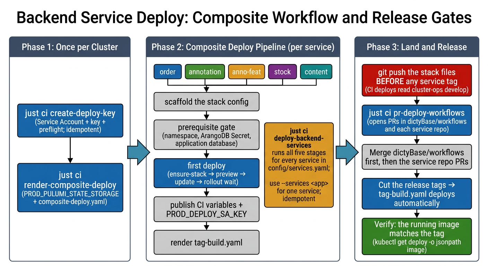

# Backend Service Deploy

One-time setup for modware gRPC services (`order`, `annotation`, `anno-feat`,
`stock`, `content`) on a target cluster: performs the first cluster deploy and
wires automated GitHub Actions tag deploys. Run the recipes in a `cluster-env`
shell of the target cluster (`CLUSTER_NAME`, `CLUSTER_ENV`, `PULUMI_STACK`).

The flow uses composite recipes. You can run `deploy-backend-services` for all
services at once or one service at a time with `--services <app>`; individual
step recipes are in [section 6](#6-individual-recipes).

**Status**: Production procedure. Use `Pulumi.dcr-kube1.yaml` configs only. Do
not edit the lab `experiments`/`local` stacks of `modware-order`,
`modware-annotation`, `modware-annotation-feature`, `modware-stock`, or
`modware-content`.



## Table of Contents
- [Quick Reference](#quick-reference)
- [1. Create the deployer key](#1-create-the-deployer-key)
- [2. Prepare the composite deploy workflow](#2-prepare-the-composite-deploy-workflow)
- [3. Deploy all backend services](#3-deploy-all-backend-services)
- [4. Push the stack files](#4-push-the-stack-files)
- [5. Open workflow pull requests](#5-open-workflow-pull-requests)
- [6. Individual recipes](#6-individual-recipes)
  - [6.1 Verify the cluster registry](#61-verify-the-cluster-registry)
  - [6.2 Scaffold the stack config](#62-scaffold-the-stack-config)
  - [6.3 Check cluster prerequisites](#63-check-cluster-prerequisites)
  - [6.4 First deploy](#64-first-deploy)
  - [6.5 Publish CI credentials and variables](#65-publish-ci-credentials-and-variables)
  - [6.6 Render the tag workflow](#66-render-the-tag-workflow)
- [7. Verify](#7-verify)
- [8. Troubleshooting](#8-troubleshooting)
- [9. Related Documents](#9-related-documents)

## Quick Reference

```bash
# once per cluster:
just ci create-deploy-key                       # 1. SA + key + preflight (idempotent)
just ci render-composite-deploy                 # 2. PROD_PULUMI_STATE_STORAGE + composite-deploy.yaml render
# every service run — scaffold → gate → deploy → vars → render:
just ci deploy-backend-services                 # 3. all services in config/services.yaml
git add modware-*/Pulumi.dcr-kube1.yaml && git commit && git push   # 4. stack files BEFORE any tag
just ci pr-deploy-workflows                     # 5. open PRs in dictyBase/workflows + service repos
# then: merge the PRs and cut tags
```

Single-service rollout (recommended on a first cluster setup — run in
`config/services.yaml` order: `order`, `annotation`, `anno-feat`, `stock`,
`content`, then finish with an unfiltered `just ci deploy-backend-services` to
confirm all five converged) or step-by-step diagnostics —
[section 6](#6-individual-recipes):

```bash
just ci deploy-backend-services --services order
just ci deploy-backend-services --services annotation
just ci deploy-backend-services --services anno-feat
just ci deploy-backend-services --services stock
just ci deploy-backend-services --services content
```

## 1. Create the deployer key

The recipe creates the deployer service account and its key at the standard
path `credentials/<cluster>/deployer.json`, then verifies the key with
`check-deploy-credentials`. An existing key file stays in use — the recipe does
not create a second key.
→ [Deploy credential details](reference/backend/ci-credentials.md)

```bash
just ci create-deploy-key
```

## 2. Prepare the composite deploy workflow

One-time setup for automated GitHub Actions deploys: publishes org variable
`PROD_PULUMI_STATE_STORAGE` and renders `bin/ci-render/composite-deploy.yaml`
so `dictyBase/workflows` selects `PROD_DEPLOY_SA_KEY` and the production Pulumi
state bucket when `environment: production` is passed (leaving `develop` push
deploys on the dev defaults).
→ [Workflow render details](reference/backend/render-deploy-workflows.md)

```bash
just ci render-composite-deploy
```

## 3. Deploy all backend services

**WARNING: Push cluster-ops `develop` before any service tag.** CI deploys
read cluster-ops from `develop`. An unpushed stack file deploys nothing.

Runs scaffold, prerequisite gate, first deploy, repo variables, tag-workflow
render (`bin/ci-render/<folder>-tag-build.yaml`), and `PROD_DEPLOY_SA_KEY`
repo visibility for every service in `config/services.yaml` (idempotent —
skips completed steps). For a conservative first rollout, pass
`--services <app>` one service at a time (`order` → `annotation` → `anno-feat` →
`stock` → `content`), then run once without `--services`.
→ [Aggregate deploy details](reference/backend/deploy-services.md)

```bash
just ci deploy-backend-services
```

## 4. Push the stack files

The stack configs must live on cluster-ops `develop` — CI deploys read them
from there at deploy time.
→ [First deploy details](reference/backend/bootstrap-service.md)

```bash
git add modware-*/Pulumi.dcr-kube1.yaml && git commit -m "stacks for <cluster>" && git push
```

## 5. Open workflow pull requests

One-time PR automation for GitHub Actions: updates
`.github/workflows/composite-deploy.yaml` in `dictyBase/workflows` and replaces
`.github/workflows/tag-build.yaml` (one `composite-deploy` call, deleting
obsolete `staging-build.yaml`) in each service repo. Merge `dictyBase/workflows`
first, then the service repo PRs — every subsequent release tag deploys
automatically.
→ [Workflow render details](reference/backend/render-deploy-workflows.md)

```bash
just ci pr-deploy-workflows
```

## 6. Individual recipes

Use these recipes for single-service runs and for diagnostics. Each recipe
also runs alone.

### 6.1 Verify the cluster registry

Later steps read the registry entry. The `register-cluster` recipe creates
entries from bootstrap artifacts.
→ [Registry details](reference/backend/cluster-registry.md)

```bash
just gcp-cluster registry-show
```

### 6.2 Scaffold the stack config

The recipe creates `<folder>/Pulumi.<stack>.yaml` from the template and
initializes the stack in the Pulumi backend. The recipe stops with an error
when the file already exists.
→ [Scaffold details](reference/backend/scaffold-backend-stack.md)

```bash
just gcp-pulumi scaffold-backend-stack --folder modware-order
```

### 6.3 Check cluster prerequisites

The recipe does a read-only probe of these items: the namespace, the ArangoDB
credentials Secret, and the application database. The database probe goes
through the Service that the app connects to. The recipe exits non-zero and
lists each missing prerequisite.
→ [Prerequisites details](reference/backend/prerequisites.md)

```bash
just gcp-pulumi check-backend-prereqs --folder modware-order
```

### 6.4 First deploy

The recipe runs these steps in a fixed order: prereq gate → ensure-stack →
preview → update → rollout wait + image check. Prerequisites come first — the
recipe touches nothing when a prerequisite fails. The recipe is idempotent —
when the deployment runs the wanted tag, it checks the rollout only.
→ [First deploy details](reference/backend/bootstrap-service.md)

```bash
just gcp-pulumi bootstrap-service --folder modware-order
```

### 6.5 Publish CI credentials and variables

The recipes do these steps: key preflight, org-secret publish, and the
`<PROD>_*` repo variables.
→ [CI credentials details](reference/backend/ci-credentials.md)
→ [CI variables details](reference/backend/ci-variables.md)

```bash
just ci check-deploy-credentials
```

### 6.6 Render the tag workflow

The recipe renders the deploy-only `tag-build.yaml` — one `composite-deploy`
call pointed at the production cluster; the PR that lands it also removes the
dead `staging-build.yaml`.
→ [Workflow render details](reference/backend/render-deploy-workflows.md)

```bash
just ci render-tag-deploy --app order --project modware-order --out tag-build.yaml
```

## 7. Verify

After the first tag deploy, the running image must match the tag. The service
must answer inside the cluster.
→ [Verification details](reference/backend/bootstrap-service.md#verification)

```bash
kubectl -n prod get deploy order-api-server -o jsonpath='{.spec.template.spec.containers[0].image}'
```

## 8. Troubleshooting

→ [Troubleshooting details](reference/backend/troubleshooting.md)

## 9. Related Documents

- [GraphQL server deploy guide](graphql-deploy.md)
- [Aggregate deploy details](reference/backend/deploy-services.md)
- [Upstream deploy refactor plan](plans/upstream-deploy-refactor.md)
- [Modware service plan](plans/modware-service-any-cluster.md)
- [ArangoDB deploy guide](arangodb-deploy.md)
- [kOps cluster setup](kops-setup.md)