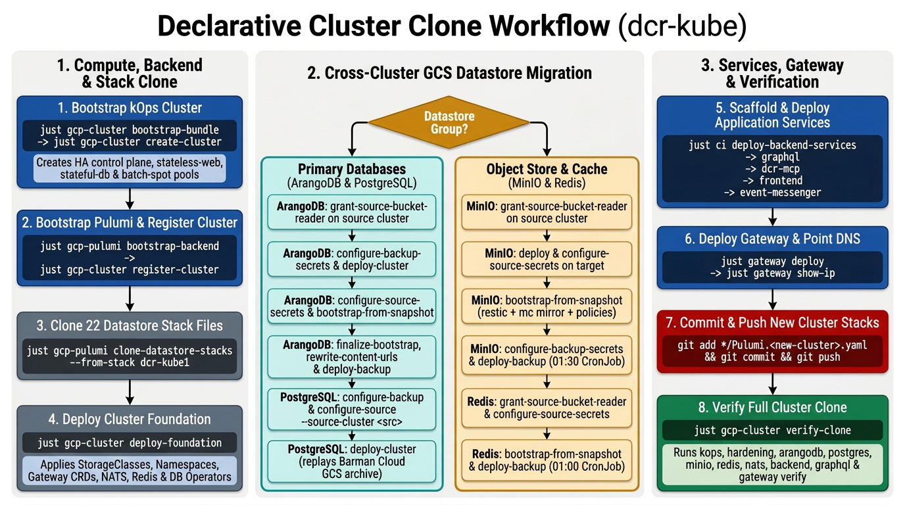

# Declarative Cluster Clone Guide

End-to-end runbook for cloning a production `dcr-kube` (`dcr-kube1`) cluster into a new GCP project and cluster using `kOps`, Pulumi, and GCS datastore archives (`ArangoDB`, `PostgreSQL`, `MinIO`, and `Redis`).

**Status**: Production procedure. Uses declarative Git manifests, Pulumi stacks, and application-consistent GCS datastore snapshots instead of Velero disk snapshots so Pulumi state and ArangoDB Raft consensus remain clean.



## Table of Contents

- [Quick Reference](#quick-reference)
- [1. Bootstrap the Target kOps Cluster](#1-bootstrap-the-target-kops-cluster)
- [2. Bootstrap Pulumi and Register the Cluster](#2-bootstrap-pulumi-and-register-the-cluster)
- [3. Clone the Datastore Stack Files](#3-clone-the-datastore-stack-files)
- [4. Deploy the Cluster Foundation](#4-deploy-the-cluster-foundation)
- [5. Migrate ArangoDB from the Source Cluster](#5-migrate-arangodb-from-the-source-cluster)
- [6. Migrate PostgreSQL from the Source Cluster](#6-migrate-postgresql-from-the-source-cluster)
- [7. Migrate MinIO from the Source Cluster](#7-migrate-minio-from-the-source-cluster)
- [8. Migrate Redis from the Source Cluster](#8-migrate-redis-from-the-source-cluster)
- [9. Deploy Application Services](#9-deploy-application-services)
- [10. Deploy the Gateway and Point DNS](#10-deploy-the-gateway-and-point-dns)
- [11. Push the New Cluster Files](#11-push-the-new-cluster-files)
- [12. Verify the Clone](#12-verify-the-clone)
- [13. Troubleshooting](#13-troubleshooting)
- [14. Related Documents](#14-related-documents)

---

## Quick Reference

For experienced operators. Full details are in the sections below.

```bash
# 1. Create and enter the target cluster environment, then provision kOps (~30 min)
just create-cluster-env --env prod --cluster <target-cluster> --project <target-project>
just cluster-env --env prod --cluster <target-cluster>
just prepare-tools
just gcp-cluster generate-ssh-key
just gcp-cluster bootstrap-identities
just gcp-cluster rotate-to-creator
exit
just cluster-env --env prod --cluster <target-cluster>
just gcp-cluster show-public-ip
just gcp-cluster bootstrap-bundle --api-access-cidr "<your-ip>/32"
just gcp-cluster preflight-create
just gcp-cluster create-cluster

# 2. Bootstrap the Pulumi GCS + KMS backend and register the cluster
just gcp-pulumi bootstrap-backend
just gcp-cluster register-cluster

# 3. Clone clean datastore Pulumi.<target-cluster>.yaml files from dcr-kube1
just gcp-pulumi clone-datastore-stacks --from-stack dcr-kube1

# 4. Deploy StorageClasses, namespaces, Gateway CRDs, NATS, Redis, and DB operators
just gcp-cluster deploy-foundation

# 5. Deploy ArangoDB and import data from the source cluster's GCS backup bucket
just arangodb configure-backup-secrets --restic-password '<target-restic-pass>'
just arangodb deploy-cluster --root-password '<root-password>'
just arangodb configure-source-secrets \
  --restic-password '<source-restic-pass>' \
  --gcs-project <source-project> \
  --gcs-key-file credentials/<source-project>/arangodb-restic-reader.json
just arangodb bootstrap-from-snapshot --namespace prod --bucket restic-arangodb-backup-prod
just arangodb finalize-bootstrap --app-user '<app-user>' --app-password '<app-password>'
just arangodb deploy-backup

# 6. Deploy PostgreSQL 16 and recover data from the source cluster's GCS backup bucket
just postgres configure-backup
just postgres configure-source --source-cluster <source-cluster>
just postgres deploy-cluster --app-password '<pg-app-password>'

# 7. Deploy MinIO, bootstrap buckets from the source GCS backup bucket, and enable daily backup
just minio deploy --root-user '<minio-user>' --root-password '<minio-password>'
just minio configure-source-secrets \
  --restic-password '<source-minio-restic-pass>' \
  --gcs-project <source-project> \
  --gcs-key-file credentials/<source-project>/minio-restic-reader.json
just minio bootstrap-from-snapshot --namespace prod --bucket restic-minio-backup-<source-project>
just minio configure-backup-secrets --restic-password '<target-minio-restic-pass>'
just minio deploy-backup

# 8. Bootstrap Redis from the source GCS backup bucket and enable daily backup
just redis configure-source-secrets \
  --restic-password '<source-redis-restic-pass>' \
  --gcs-project <source-project> \
  --gcs-key-file credentials/<source-project>/redis-restic-reader.json
just redis bootstrap-from-snapshot --namespace prod --bucket restic-redis-backup-<source-project>
just redis configure-backup-secrets --restic-password '<target-redis-restic-pass>'
just redis deploy-backup

# 9. Scaffold and deploy backend gRPC services, GraphQL, dcr-mcp, frontend, and event-messenger
just ci create-deploy-key
just ci render-composite-deploy
just ci deploy-backend-services
just gcp-pulumi scaffold-graphql-stack --store-endpoint https://<target-minio-host>
just gcp-pulumi create-resource --folder graphql_server
just gcp-pulumi scaffold-dcr-mcp-stack
just gcp-pulumi create-resource --folder dcr-mcp
just gcp-pulumi scaffold-frontend-stack
just gcp-pulumi create-resource --folder frontend_application

# 10. Scaffold and deploy the Cilium Gateway, then point DNS A records to its IP
just gcp-pulumi scaffold-gateway-stack
just gateway deploy
just gateway show-ip

# 11. Commit and push all new cluster manifests and stack configs
git add "config/kops/${CLUSTER_NAME}/" "config/clusters/${CLUSTER_NAME}.yaml" "*/Pulumi.${PULUMI_STACK}.yaml"
git commit -m "${CLUSTER_NAME}: clone cluster configuration" && git push

# 12. Verify all layers of the cloned cluster
just gcp-cluster verify-clone
```

---

**All of the commands below run in the target cluster's `cluster-env` sub-shell unless labeled otherwise.**

- Enter the sub-shell with `just cluster-env --env prod --cluster <target-cluster>`. The sub-shell exports `CLUSTER_NAME`, `CLUSTER_ENV`, `PULUMI_STACK`, `PULUMI_BACKEND_URL`, `PULUMI_GCP_CREDENTIALS`, `PULUMI_SECRET_PROVIDER`, `PROJECT_ID`, and `KUBECONFIG`.
- Leave the sub-shell with `exit` or Ctrl-D.

## 1. Bootstrap the Target kOps Cluster

Create the target cluster environment, set up the service accounts, render the Git manifest bundle, and create the kOps cluster.
→ [Cluster bootstrap details](reference/cluster/clone.md#bootstrap-kops-compute-and-pulumi-backend) · [`kops-setup.md`](kops-setup.md)

```bash
just create-cluster-env --env prod --cluster <target-cluster> --project <target-project>
just cluster-env --env prod --cluster <target-cluster>
just prepare-tools
just gcp-cluster generate-ssh-key
just gcp-cluster bootstrap-identities
just gcp-cluster rotate-to-creator
exit
just cluster-env --env prod --cluster <target-cluster>
just gcp-cluster show-public-ip
just gcp-cluster bootstrap-bundle --api-access-cidr "<your-ip>/32"
git add "config/kops/${CLUSTER_NAME}/" && git commit -m "${CLUSTER_NAME}: initial cluster manifest bundle"
just gcp-cluster preflight-create
just gcp-cluster create-cluster
```

---

## 2. Bootstrap Pulumi and Register the Cluster

Initialize the KMS keyring, the versioned Pulumi GCS state bucket, and the `config/clusters/${CLUSTER_NAME}.yaml` registry entry that all `scaffold-*-stack` recipes read.
→ [Cluster registration](reference/backend/cluster-registry.md) · [`pulumi-setup.md`](pulumi-setup.md)

```bash
just gcp-pulumi bootstrap-backend
just gcp-cluster register-cluster
```

---

## 3. Clone the Datastore Stack Files

Copy the 22 infrastructure and datastore `Pulumi.dcr-kube1.yaml` files to `Pulumi.${PULUMI_STACK}.yaml` with foreign KMS headers and `secure:` blocks removed and `gcp:project` rewritten to `$PROJECT_ID`.
→ [`just gcp-pulumi clone-datastore-stacks`](reference/cluster/clone.md#just-gcp-pulumi-clone-datastore-stacks)

```bash
just gcp-pulumi clone-datastore-stacks --from-stack dcr-kube1
```

---

## 4. Deploy the Cluster Foundation

Apply the StorageClasses, shared namespaces (`operators` and `prod`), Gateway API CRDs, NATS, standalone Redis, and the CloudNativePG and ArangoDB operators in one composite run.
→ [`just gcp-cluster deploy-foundation`](reference/cluster/clone.md#just-gcp-cluster-deploy-foundation)

```bash
just gcp-cluster deploy-foundation
```

---

## 5. Migrate ArangoDB from the Source Cluster

Grant read access to the source ArangoDB backup bucket from the **source** cluster shell, then return to the **target** cluster shell to deploy ArangoDB, restore the snapshot, rotate passwords, and rewrite content URLs if the storage domain changed.
→ [ArangoDB snapshot import](reference/cluster/clone.md#arangodb-snapshot-import-and-url-rewrite) · [`arangodb-deploy.md`](arangodb-deploy.md)

**In the SOURCE cluster sub-shell (`dcr-kube1`):**

```bash
exit
just cluster-env --env prod --cluster <source-cluster>
just arangodb grant-source-bucket-reader
just arangodb source-secret-value --namespace prod
just arangodb source-app-user --namespace prod
```

---

**In the TARGET cluster sub-shell (`<target-cluster>`):**

```bash
exit
just cluster-env --env prod --cluster <target-cluster>
just arangodb configure-backup-secrets --restic-password '<target-restic-pass>'
just arangodb deploy-cluster --root-password '<root-password>'
just arangodb configure-source-secrets \
  --restic-password '<source-restic-pass>' \
  --gcs-project <source-project> \
  --gcs-key-file credentials/<source-project>/arangodb-restic-reader.json
just arangodb bootstrap-from-snapshot --namespace prod --bucket restic-arangodb-backup-prod
just arangodb finalize-bootstrap --app-user '<app-user>' --app-password '<app-password>'
just arangodb rewrite-content-urls \
  --old-url https://<source-minio-host> \
  --new-url https://<target-minio-host> \
  --apply yes
just arangodb deploy-backup
```

---

## 6. Migrate PostgreSQL from the Source Cluster

Configure the target Barman Cloud backup identity, register the source cluster's backup bucket as the recovery source, and deploy the PostgreSQL 16 cluster.
→ [PostgreSQL recovery or logical import](reference/cluster/clone.md#postgresql-recovery-or-logical-import) · [`postgres-deploy.md`](postgres-deploy.md)

```bash
just postgres configure-backup
just postgres configure-source --source-cluster <source-cluster>
just postgres deploy-cluster --app-password '<pg-app-password>'
```

---

## 7. Migrate MinIO from the Source Cluster

Grant read access to the source MinIO backup bucket from the **source** cluster shell, then return to the **target** cluster shell to deploy MinIO, restore all buckets and anonymous S3 policies from `gs://restic-minio-backup-<source-project>`, and enable daily backups on the target cluster.
→ [MinIO snapshot bootstrap and backup](reference/cluster/clone.md#minio-snapshot-bootstrap-and-backup) · [`minio-deploy.md`](minio-deploy.md)

**In the SOURCE cluster sub-shell (`dcr-kube1`):**

```bash
exit
just cluster-env --env prod --cluster <source-cluster>
just minio grant-source-bucket-reader
just minio source-secret-value --namespace prod
```

---

**In the TARGET cluster sub-shell (`<target-cluster>`):**

```bash
exit
just cluster-env --env prod --cluster <target-cluster>
just minio deploy --root-user '<minio-user>' --root-password '<minio-password>'
just minio configure-source-secrets \
  --restic-password '<source-minio-restic-pass>' \
  --gcs-project <source-project> \
  --gcs-key-file credentials/<source-project>/minio-restic-reader.json
just minio bootstrap-from-snapshot \
  --namespace prod \
  --bucket restic-minio-backup-<source-project>
just minio configure-backup-secrets --restic-password '<target-minio-restic-pass>'
just minio deploy-backup
```

---

## 8. Migrate Redis from the Source Cluster

Grant read access to the source Redis backup bucket from the **source** cluster shell, then return to the **target** cluster shell to restore the RDB snapshot into Redis and enable daily backups on the target cluster.
→ [Redis snapshot bootstrap and backup](reference/cluster/clone.md#redis-snapshot-bootstrap-and-backup) · [`redis-deploy.md`](redis-deploy.md)

**In the SOURCE cluster sub-shell (`dcr-kube1`):**

```bash
exit
just cluster-env --env prod --cluster <source-cluster>
just redis grant-source-bucket-reader
just redis source-secret-value --namespace prod
```

---

**In the TARGET cluster sub-shell (`<target-cluster>`):**

```bash
exit
just cluster-env --env prod --cluster <target-cluster>
just redis configure-source-secrets \
  --restic-password '<source-redis-restic-pass>' \
  --gcs-project <source-project> \
  --gcs-key-file credentials/<source-project>/redis-restic-reader.json
just redis bootstrap-from-snapshot \
  --namespace prod \
  --bucket restic-redis-backup-<source-project>
just redis configure-backup-secrets --restic-password '<target-redis-restic-pass>'
just redis deploy-backup
```

---

## 9. Deploy Application Services

Deploy the five modware gRPC services first so their Kubernetes Services exist before `graphql_server` and `event-messenger` pods start, then scaffold and deploy `graphql_server`, `dcr-mcp`, `frontend_application`, and `event-messenger`.
→ [Scaffold and deploy application services](reference/cluster/clone.md#scaffold-and-deploy-application-services)

```bash
just ci create-deploy-key
just ci render-composite-deploy
just ci deploy-backend-services

just gcp-pulumi scaffold-graphql-stack --store-endpoint https://<target-minio-host>
just gcp-pulumi set-config --folder graphql_server --key properties.image.tag --value <graphql-tag>
just gcp-pulumi create-resource --folder graphql_server

just gcp-pulumi scaffold-dcr-mcp-stack
just gcp-pulumi set-config --folder dcr-mcp --key properties.image.tag --value <dcr-mcp-tag>
just gcp-pulumi create-resource --folder dcr-mcp

just gcp-pulumi scaffold-frontend-stack
just gcp-pulumi set-config --folder frontend_application --key properties.apps.frontpage.tag --value <frontpage-tag>
just gcp-pulumi set-config --folder frontend_application --key properties.apps.publication.tag --value <publication-tag>
just gcp-pulumi set-config --folder frontend_application --key properties.apps.stockcenter.tag --value <stockcenter-tag>
just gcp-pulumi set-config --folder frontend_application --key properties.apps.genomepage.tag --value <genomepage-tag>
just gcp-pulumi create-resource --folder frontend_application
```

---

## 10. Deploy the Gateway and Point DNS

Scaffold the `gateway/` stack, set the ACME email and route hostnames, deploy `dictycr-gateway`, and point your DNS `A` records at the external LoadBalancer IP address printed by `show-ip`.
→ [Deploy the Gateway and cut over DNS](reference/cluster/clone.md#deploy-the-gateway-and-cut-over-dns) · [`gateway-deploy.md`](gateway-deploy.md)

```bash
just gcp-pulumi scaffold-gateway-stack
just gcp-pulumi set-config --folder gateway --key properties.issuer.email --value <acme-email>
just gcp-pulumi set-config --folder gateway --key properties.routes.frontend.hosts.0 --value <frontend-host>
just gcp-pulumi set-config --folder gateway --key properties.routes.graphql.hosts.0 --value <graphql-host>
just gcp-pulumi set-config --folder gateway --key properties.routes.minio.hosts.0 --value <target-minio-host>
just gateway deploy
just gateway show-ip
```

---

## 11. Push the New Cluster Files

**CAUTION: Push the new cluster manifests, registry entry, and stack files to `develop` before any release tag workflow runs.**
→ [Commit and push the cloned stack files](reference/cluster/clone.md#commit-and-push-the-cloned-stack-files)

```bash
git add "config/kops/${CLUSTER_NAME}/" "config/clusters/${CLUSTER_NAME}.yaml" "*/Pulumi.${PULUMI_STACK}.yaml"
git commit -m "${CLUSTER_NAME}: clone cluster configuration"
git push
```

---

## 12. Verify the Clone

Run the read-only verification suite across all cluster layers after DNS `A` records resolve.
→ [`just gcp-cluster verify-clone`](reference/cluster/clone.md#just-gcp-cluster-verify-clone)

```bash
just gcp-cluster verify-clone
```

---

## 13. Troubleshooting

→ [Troubleshooting table](reference/cluster/clone.md#troubleshooting)

---

## 14. Related Documents

**Reference details for this guide:**
- [Declarative cluster clone details](reference/cluster/clone.md)
- [Clone datastore stack configurations](reference/cluster/clone.md#clone-datastore-stack-configurations)
- [Deploy the cluster foundation](reference/cluster/clone.md#deploy-the-cluster-foundation)
- [Migrate stateful datastores](reference/cluster/clone.md#migrate-stateful-datastores)
- [Verification](reference/cluster/clone.md#verification)
- [Troubleshooting](reference/cluster/clone.md#troubleshooting)

**Other documentation:**
- Cluster bootstrap: [`kops-setup.md`](kops-setup.md)
- Pulumi backend and StorageClasses: [`pulumi-setup.md`](pulumi-setup.md)
- ArangoDB deploy and import: [`arangodb-deploy.md`](arangodb-deploy.md)
- PostgreSQL deploy and recovery: [`postgres-deploy.md`](postgres-deploy.md)
- MinIO deploy, backup, and restore: [`minio-deploy.md`](minio-deploy.md)
- Redis deploy, backup, and restore: [`redis-deploy.md`](redis-deploy.md)
- NATS deploy: [`nats-deploy.md`](nats-deploy.md)
- Backend gRPC services: [`backend-service-deploy.md`](backend-service-deploy.md)
- GraphQL server: [`graphql-deploy.md`](graphql-deploy.md)
- MCP server (`dcr-mcp`): [`dcr-mcp-deploy.md`](dcr-mcp-deploy.md)
- Frontend applications: [`frontend-deploy.md`](frontend-deploy.md)
- Event Messenger: [`event-messenger-deploy.md`](event-messenger-deploy.md)
- Cilium Gateway: [`gateway-deploy.md`](gateway-deploy.md)
- Legacy Velero backup: [`velero-deploy.md`](velero-deploy.md)
