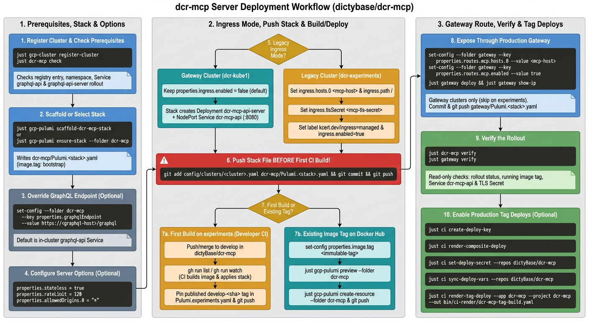

# dcr-mcp Server Deploy

The `dcr-mcp/` Pulumi project deploys **dcr-mcp** (`dictybase/dcr-mcp`), the dictyBase Stock Center Model Context Protocol (MCP) server, into one namespace. The project creates the Deployment `dcr-mcp-api-server` and the NodePort Service `dcr-mcp-api` on port `8080`. The server reads the dictyBase GraphQL server over HTTP, and it needs no database, no Secret, and no volume.

**The per-app TLS Ingress is optional, and it is off by default.** With the default, the stack creates the Deployment and the Service only, and the central Cilium Gateway ([`gateway-deploy.md`](gateway-deploy.md)) routes the external traffic to a dedicated hostname at root path `/`. [Section 6](#6-configure-legacy-ingress-mode-optional) gives the procedure to turn the Ingress on.

**Status**: Production procedure. Run `just gcp-pulumi scaffold-dcr-mcp-stack` to create a new cluster stack file from the registry and template, or `just gcp-pulumi ensure-stack --folder dcr-mcp` when the stack file already exists.



## Table of Contents

- [Quick Reference](#quick-reference)
- [1. Check the Prerequisites](#1-check-the-prerequisites)
- [2. Scaffold or Select the Stack](#2-scaffold-or-select-the-stack)
- [3. Pin the Image Tag](#3-pin-the-image-tag)
- [4. Override the GraphQL Endpoint (Optional)](#4-override-the-graphql-endpoint-optional)
- [5. Configure Server Options (Optional)](#5-configure-server-options-optional)
- [6. Configure Legacy Ingress Mode (Optional)](#6-configure-legacy-ingress-mode-optional)
- [7. Preview and Deploy](#7-preview-and-deploy)
- [8. Expose Through the Production Gateway](#8-expose-through-the-production-gateway)
- [9. Push the Stack Files](#9-push-the-stack-files)
- [10. Verify the Rollout](#10-verify-the-rollout)
- [11. Enable Production Tag Deploys](#11-enable-production-tag-deploys)
- [12. Troubleshooting](#12-troubleshooting)
- [13. Related Documents](#13-related-documents)

---

## Quick Reference

For experienced users. Full details in the sections below.

```bash
# Enter the cluster environment first
just cluster-env --env <env> --cluster <cluster>

# 1. Check the registry entry, the namespace, and the upstream GraphQL server
just dcr-mcp check

# 2. Scaffold the stack file on a new cluster, or select an existing stack
just gcp-pulumi scaffold-dcr-mcp-stack
just gcp-pulumi ensure-stack --folder dcr-mcp

# 3. Pin an immutable release or develop-<sha> tag (replace 'bootstrap')
just ci latest-tag --repo dictyBase/dcr-mcp
just gcp-pulumi set-config --folder dcr-mcp --key properties.image.tag --value <immutable-tag>

# 4. Optional. Read a GraphQL server outside the cluster. The default is in-cluster.
just gcp-pulumi set-config --folder dcr-mcp --key properties.graphqlEndpoint --value https://<graphql-host>/graphql

# 5. Optional. Change the server options. The defaults are shown.
just gcp-pulumi set-config --folder dcr-mcp --key properties.stateless --value true
just gcp-pulumi set-config --folder dcr-mcp --key properties.rateLimit --value 120
just gcp-pulumi set-config --folder dcr-mcp --key properties.allowedOrigins.0 --value "*"

# 6. Optional. Set the legacy Ingress mode. The default is false (no Ingress).
just gcp-pulumi set-config --folder dcr-mcp --key properties.ingress.enabled --value false

# 7. Read the plan, then apply it
just gcp-pulumi preview --folder dcr-mcp
just gcp-pulumi create-resource --folder dcr-mcp

# 8. Set the dedicated hostname, then deploy the Gateway route
just gcp-pulumi set-config --folder gateway --key properties.routes.mcp.hosts.0 --value <mcp-host>
just gcp-pulumi set-config --folder gateway --key properties.routes.mcp.enabled --value true
just gateway deploy
just gateway show-ip

# 9. Push the stack files before each dcr-mcp release tag
git add "dcr-mcp/Pulumi.${PULUMI_STACK}.yaml" "gateway/Pulumi.${PULUMI_STACK}.yaml" && git commit -m "dcr-mcp: stack config" && git push

# 10. Verify the rollout and the Gateway route
just dcr-mcp verify
just gateway verify

# 11. Optional, one time per cluster. Let release tags deploy.
just ci create-deploy-key
just ci render-composite-deploy
just ci set-deploy-secret --repos dictyBase/dcr-mcp
just ci sync-deploy-vars --repos dictyBase/dcr-mcp
just ci render-tag-deploy --app dcr-mcp --project dcr-mcp --out bin/ci-render/dcr-mcp-tag-build.yaml
```

---

**All of the commands below run in the cluster-env sub-shell.**

- Enter the sub-shell with `just cluster-env --env <env> --cluster <cluster>`. The sub-shell reads `.env.<env>.<cluster>` and exports `CLUSTER_NAME`, `CLUSTER_ENV`, `PULUMI_STACK`, `PULUMI_BACKEND_URL`, `PULUMI_GCP_CREDENTIALS`, `PROJECT_ID`, and `KUBECONFIG`.
- Each recipe defaults `--stack` to `$PULUMI_STACK`. No command below needs the flag.
- Outside the sub-shell the recipes fail with `Error: no stack name`.
- Leave the sub-shell with `exit` or Ctrl-D.

## 1. Check the Prerequisites

The recipe is read-only. It checks the cluster registry entry for this stack, the namespace, Service `graphql-api`, and the rollout of `graphql-api-server`.
→ [Prerequisites](reference/dcr-mcp/deployment.md#prerequisites) · [Cluster registration](reference/dcr-mcp/deployment.md#cluster-registration-one-time-per-cluster)

```bash
just dcr-mcp check
```

---

## 2. Scaffold or Select the Stack

On a new cluster, `scaffold-dcr-mcp-stack` initializes the stack with the cluster KMS key and writes `dcr-mcp/Pulumi.${PULUMI_STACK}.yaml` from the template and the registry entry. When the stack file already exists, run `ensure-stack` to select the stack.
→ [Create the stack](reference/dcr-mcp/deployment.md#create-the-stack)

```bash
# New cluster (creates the stack and writes dcr-mcp/Pulumi.${PULUMI_STACK}.yaml)
just gcp-pulumi scaffold-dcr-mcp-stack

# Existing stack file
just gcp-pulumi ensure-stack --folder dcr-mcp
```

---

## 3. Pin the Image Tag

The template writes the placeholder `bootstrap`. Replace it with a release tag or a `develop-<sha>` tag before you preview.
→ [Image tag](reference/dcr-mcp/deployment.md#image-tag)

```bash
just ci latest-tag --repo dictyBase/dcr-mcp
just gcp-pulumi set-config --folder dcr-mcp --key properties.image.tag --value <immutable-tag>
```

---

## 4. Override the GraphQL Endpoint (Optional)

**Optional. The default is in-cluster. Skip this section to read `graphql-api` inside the cluster.**

Set `properties.graphqlEndpoint` only when the server must read a GraphQL URL outside the cluster. The value replaces the in-cluster address.
→ [GraphQL endpoint resolution](reference/dcr-mcp/deployment.md#graphql-endpoint-resolution)

```bash
just gcp-pulumi set-config --folder dcr-mcp --key properties.graphqlEndpoint --value https://<graphql-host>/graphql
```

---

## 5. Configure Server Options (Optional)

**Optional. The template writes the production defaults. Skip this section to keep them.**

`properties.stateless` keeps each request independent, so any replica answers it. `properties.rateLimit` is the maximum number of `/mcp` requests for each client IP address in one minute, and `properties.allowedOrigins` is the CORS list for browser clients.
→ [Server options and container flags](reference/dcr-mcp/deployment.md#server-options-and-container-flags)

```bash
just gcp-pulumi set-config --folder dcr-mcp --key properties.stateless --value true
just gcp-pulumi set-config --folder dcr-mcp --key properties.rateLimit --value 120
just gcp-pulumi set-config --folder dcr-mcp --key properties.allowedOrigins.0 --value "*"
```

---

## 6. Configure Legacy Ingress Mode (Optional)

**Optional. The default is off. Skip this section on a Gateway cluster.**

The key `properties.ingress.enabled` defaults to `false`. To create the per-app `nginx` Ingress `dcr-mcp-ingress` on a legacy `kcert` cluster, set `hosts`, `path`, `tlsSecret`, and `label` first. Then set the key to `true`.
→ [Legacy Ingress mode](reference/dcr-mcp/deployment.md#legacy-ingress-mode-dcr-experiments-only)

```bash
# Keep the Ingress off (default). You can also do nothing and omit the key.
just gcp-pulumi set-config --folder dcr-mcp --key properties.ingress.enabled --value false

# Turn the Ingress on. Set the four keys first. The host is dedicated, and the path is /.
just gcp-pulumi set-config --folder dcr-mcp --key properties.ingress.hosts.0 --value <mcp-host>
just gcp-pulumi set-config --folder dcr-mcp --key properties.ingress.path --value /
just gcp-pulumi set-config --folder dcr-mcp --key properties.ingress.tlsSecret --value <mcp-tls-secret>
just gcp-pulumi set-config --folder dcr-mcp --key properties.ingress.label.name --value kcert.dev/ingress
just gcp-pulumi set-config --folder dcr-mcp --key properties.ingress.label.value --value managed
just gcp-pulumi set-config --folder dcr-mcp --key properties.ingress.enabled --value true
```

---

## 7. Preview and Deploy

Read the plan, then apply it. The apply is not interactive, and it stops by itself when the plan changes a protected resource.
→ [Deploy behavior](reference/dcr-mcp/deployment.md#deploy-behavior)

```bash
just gcp-pulumi preview --folder dcr-mcp
just gcp-pulumi create-resource --folder dcr-mcp
```

---

## 8. Expose Through the Production Gateway

The Gateway route needs Service `dcr-mcp-api`, so run [Section 7](#7-preview-and-deploy) first. Point the DNS `A` record for `<mcp-host>` at the address that `show-ip` prints.
→ [Production Gateway route](reference/dcr-mcp/deployment.md#production-gateway-route-recommended) · [Gateway MCP route](reference/gateway/deployment.md#mcp-route)

```bash
just gcp-pulumi set-config --folder gateway --key properties.routes.mcp.hosts.0 --value <mcp-host>
just gcp-pulumi set-config --folder gateway --key properties.routes.mcp.enabled --value true
just gateway deploy
just gateway show-ip
```

---

## 9. Push the Stack Files

**CAUTION: Push cluster-ops `develop` before you merge or tag `dictyBase/dcr-mcp`.** CI clones cluster-ops at `develop`, so a stack file that you did not push deploys nothing.
→ [CI deployment](reference/dcr-mcp/deployment.md#ci-deployment)

```bash
git add "dcr-mcp/Pulumi.${PULUMI_STACK}.yaml" "gateway/Pulumi.${PULUMI_STACK}.yaml" && git commit -m "dcr-mcp: stack config" && git push
```

---

## 10. Verify the Rollout

The recipe is read-only. It waits for the rollout, compares the running image with the tag in the stack file, and checks Service `dcr-mcp-api`.
→ [Verification](reference/dcr-mcp/deployment.md#verification)

```bash
just dcr-mcp verify
just gateway verify
```

---

## 11. Enable Production Tag Deploys

**Optional. Do this one time for each cluster. Skip it while production deploys stay manual.**

`dcr-mcp` is absent from `config/services.yaml`, so the bulk backend recipes do not cover it. These five recipes mint the deployer key, publish the credential and the `<CI_ENV>_*` variables, and render a tag workflow file that does nothing until a pull request adds it to `dictyBase/dcr-mcp`.
→ [Tag deploy setup](reference/dcr-mcp/deployment.md#tag-deploy-setup)

```bash
just ci create-deploy-key
just ci render-composite-deploy
just ci set-deploy-secret --repos dictyBase/dcr-mcp
just ci sync-deploy-vars --repos dictyBase/dcr-mcp
just ci render-tag-deploy --app dcr-mcp --project dcr-mcp --out bin/ci-render/dcr-mcp-tag-build.yaml
```

---

## 12. Troubleshooting

→ [Troubleshooting table](reference/dcr-mcp/deployment.md#troubleshooting)

---

## 13. Related Documents

**Reference details for this guide:**
- [dcr-mcp server deployment details](reference/dcr-mcp/deployment.md)

**Other documents:**
- Gateway routing (`gateway/`): [`gateway-deploy.md`](gateway-deploy.md)
- Upstream GraphQL server (`graphql_server/`): [`graphql-deploy.md`](graphql-deploy.md)
- Cluster bootstrap and the `cluster-env` sub-shell: [`pulumi-setup.md`](pulumi-setup.md)
- Cluster registry (`config/clusters/<cluster>.yaml`): [`reference/backend/cluster-registry.md`](reference/backend/cluster-registry.md)
- CI credentials and variables: [`reference/backend/ci-credentials.md`](reference/backend/ci-credentials.md), [`reference/backend/ci-variables.md`](reference/backend/ci-variables.md)
- Shared namespaces: [`reference/pulumi/namespaces.md`](reference/pulumi/namespaces.md)
