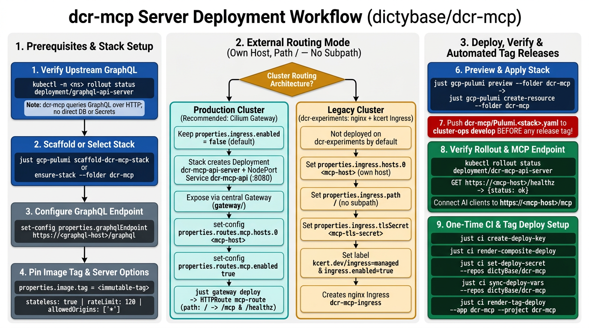

# dcr-mcp Server Deploy

The `dcr-mcp/` Pulumi project deploys **dcr-mcp** (`dictybase/dcr-mcp`), the dictyBase Stock Center Model Context Protocol (MCP) server, into one namespace. The project creates the Deployment `dcr-mcp-api-server` and the NodePort Service `dcr-mcp-api` on port `8080`. The server exposes 12 read-only MCP tools and 4 research prompts over Streamable HTTP at `/mcp` and a health check at `/healthz`, and it queries the dictyBase GraphQL server over HTTP (`--graphql-endpoint`). It needs no database credentials, no Kubernetes Secret, and no PersistentVolumeClaim.

**Production Gateway routing is the recommended setup (`properties.ingress.enabled: false` by default).** On production clusters (`dcr-kube1`), the `dcr-mcp/` stack creates the Deployment and the Service only, and the central Cilium Gateway ([`gateway-deploy.md`](gateway-deploy.md)) exposes `dcr-mcp-api` on its own dedicated hostname at root path `/` (no URL subpath). `dcr-mcp` is not deployed on the legacy `dcr-experiments` cluster by default. If you deploy it on a legacy cluster, turn on the per-app `nginx` Ingress ([Section 6](#6-configure-legacy-ingress-mode-optional)) with its own dedicated hostname and `path: /` (no subpath).

**Status**: Production procedure. Run `just gcp-pulumi scaffold-dcr-mcp-stack` to create a new cluster stack file from the registry and template, or `just gcp-pulumi ensure-stack --folder dcr-mcp` when the stack file already exists.



## Table of Contents

- [Quick Reference](#quick-reference)
- [1. Verify the Upstream GraphQL Server](#1-verify-the-upstream-graphql-server)
- [2. Scaffold or Select the Stack](#2-scaffold-or-select-the-stack)
- [3. Configure the GraphQL Endpoint](#3-configure-the-graphql-endpoint)
- [4. Pin the Image Tag](#4-pin-the-image-tag)
- [5. Configure Server Options (Optional)](#5-configure-server-options-optional)
- [6. Configure Legacy Ingress Mode (Optional)](#6-configure-legacy-ingress-mode-optional)
- [7. Preview and Deploy](#7-preview-and-deploy)
- [8. Expose Through the Production Gateway](#8-expose-through-the-production-gateway)
- [9. Push the Stack Files](#9-push-the-stack-files)
- [10. Verify the Rollout](#10-verify-the-rollout)
- [11. Enable Production Tag Deploys](#11-enable-production-tag-deploys)
  - [11.1 Create the Deployer Key](#111-create-the-deployer-key)
  - [11.2 Prepare the Composite Deploy Workflow](#112-prepare-the-composite-deploy-workflow)
  - [11.3 Publish CI Credentials and Variables](#113-publish-ci-credentials-and-variables)
  - [11.4 Render the Tag Workflow](#114-render-the-tag-workflow)
- [12. Troubleshooting](#12-troubleshooting)
- [13. Related Documents](#13-related-documents)

---

## Quick Reference

For experienced users. Full details in the sections below.

```bash
# Enter the cluster environment first
just cluster-env --env <env> --cluster <cluster>

# 1. Verify the upstream GraphQL server in the target namespace
kubectl -n <namespace> rollout status deployment/graphql-api-server

# 2. Scaffold the stack file on a new cluster, or select an existing stack
just gcp-pulumi scaffold-dcr-mcp-stack --graphql-endpoint https://<graphql-host>/graphql
just gcp-pulumi ensure-stack --folder dcr-mcp

# 3. Set the upstream GraphQL endpoint URL
just gcp-pulumi set-config --folder dcr-mcp --key properties.graphqlEndpoint --value https://<graphql-host>/graphql

# 4. Pin an immutable release or develop-<sha> image tag (replace 'bootstrap')
just gcp-pulumi set-config --folder dcr-mcp --key properties.image.tag --value <immutable-tag>

# 5. Optional. Adjust stateless mode, rate limit, or CORS origins (defaults shown)
just gcp-pulumi set-config --folder dcr-mcp --key properties.stateless --value true
just gcp-pulumi set-config --folder dcr-mcp --key properties.rateLimit --value 120
just gcp-pulumi set-config --folder dcr-mcp --key properties.allowedOrigins.0 --value "*"

# 6. Optional (legacy dcr-experiments only). Keep false on Gateway clusters (default).
just gcp-pulumi set-config --folder dcr-mcp --key properties.ingress.enabled --value false

# 7. Read the plan, then apply it
just gcp-pulumi preview --folder dcr-mcp
just gcp-pulumi create-resource --folder dcr-mcp

# 8. Expose dcr-mcp on its own host (path /, no subpath) through the production Gateway
just gcp-pulumi set-config --folder gateway --key properties.routes.mcp.hosts.0 --value <mcp-host>
just gcp-pulumi set-config --folder gateway --key properties.routes.mcp.enabled --value true
just gateway deploy

# 9. Push the stack files before any dcr-mcp release tag
git add "dcr-mcp/Pulumi.${PULUMI_STACK}.yaml" "gateway/Pulumi.${PULUMI_STACK}.yaml" && git commit -m "dcr-mcp: stack config" && git push

# 10. Verify the rollout and the Gateway route
kubectl -n <namespace> rollout status deployment/dcr-mcp-api-server
just gateway verify

# 11. Optional, one time per cluster. Wire automated GitHub Actions tag deploys.
just ci create-deploy-key
just ci render-composite-deploy
just ci set-deploy-secret --repos dictyBase/dcr-mcp
just ci sync-deploy-vars --repos dictyBase/dcr-mcp
just ci render-tag-deploy --app dcr-mcp --project dcr-mcp --out bin/ci-render/dcr-mcp-tag-build.yaml
```

---

**All of the commands below run in the cluster-env sub-shell.**

- Enter the sub-shell with `just cluster-env --env <env> --cluster <cluster>`. The sub-shell reads `.env.<env>.<cluster>` and exports `CLUSTER_NAME`, `CLUSTER_ENV`, `PULUMI_STACK`, `PULUMI_BACKEND_URL`, `PULUMI_GCP_CREDENTIALS`, `PULUMI_SECRET_PROVIDER`, `PROJECT_ID`, and `KUBECONFIG`.
- Each recipe defaults `--stack` to `$PULUMI_STACK` and `--cluster` to `$CLUSTER_NAME`. No command below needs those flags.
- Outside the sub-shell the recipes fail with `ERROR: no stack name` or `ERROR: no cluster name`.
- Leave the sub-shell with `exit` or Ctrl-D.

## 1. Verify the Upstream GraphQL Server

`dcr-mcp` resolves all stock, gene, phenotype, and publication queries through the dictyBase GraphQL endpoint. Confirm that `graphql-api-server` is running in the namespace before you deploy `dcr-mcp`. Unlike `graphql_server` and `event-messenger`, `dcr-mcp` does not read Kubernetes `*_SERVICE_HOST` variables at startup, so pod startup order does not cause a crash loop.
→ [Prerequisites](reference/dcr-mcp/deployment.md#prerequisites) · [GraphQL endpoint](reference/dcr-mcp/deployment.md#graphql-endpoint)

```bash
kubectl -n <namespace> rollout status deployment/graphql-api-server
```

---

## 2. Scaffold or Select the Stack

On a new cluster, run `scaffold-dcr-mcp-stack` to initialize the stack with the cluster KMS key and render `dcr-mcp/Pulumi.${PULUMI_STACK}.yaml` from `config/templates/dcr-mcp-stack.yaml.tmpl`. When `gateway/Pulumi.${PULUMI_STACK}.yaml` already defines `routes.graphql.hosts[0]`, the recipe derives `https://<graphql-host>/graphql` automatically. Pass `--graphql-endpoint` to override it. When the stack file already exists, run `ensure-stack` to select the stack.
→ [Create the stack](reference/dcr-mcp/deployment.md#create-the-stack)

```bash
# New cluster (creates the stack and writes dcr-mcp/Pulumi.${PULUMI_STACK}.yaml)
just gcp-pulumi scaffold-dcr-mcp-stack --graphql-endpoint https://<graphql-host>/graphql

# Existing stack file
just gcp-pulumi ensure-stack --folder dcr-mcp
```

---

## 3. Configure the GraphQL Endpoint

Set `properties.graphqlEndpoint` to the full GraphQL query URL of the target cluster (for example, `https://graphql.dictycr.org/graphql` on `dcr-kube1`, or `http://graphql-api.prod.svc.cluster.local:8080/graphql` for in-cluster HTTP). Pulumi passes this value to `--graphql-endpoint`.
→ [GraphQL endpoint](reference/dcr-mcp/deployment.md#graphql-endpoint)

```bash
just gcp-pulumi set-config --folder dcr-mcp --key properties.graphqlEndpoint --value https://<graphql-host>/graphql
```

---

## 4. Pin the Image Tag

The scaffold template sets `properties.image.tag` to the placeholder `bootstrap`. Resolve the latest published semver tag from `dictyBase/dcr-mcp` with `just ci latest-tag` or pin a specific release or `develop-<sha>` tag before you preview or deploy.
→ [Server options and container flags](reference/dcr-mcp/deployment.md#server-options-and-container-flags)

```bash
just ci latest-tag --repo dictyBase/dcr-mcp
just gcp-pulumi set-config --folder dcr-mcp --key properties.image.tag --value <immutable-tag>
```

---

## 5. Configure Server Options (Optional)

**Optional. The scaffold template writes the production defaults (`stateless: true`, `rateLimit: 120`, `allowedOrigins: ["*"]`). Skip this section to keep the defaults.**

Keep `properties.stateless` set to `true` so any pod replica can serve any Streamable HTTP request without sticky sessions. Adjust `properties.rateLimit` (maximum `/mcp` requests per client IP address per minute) or restrict `properties.allowedOrigins` when browser MCP clients require a closed CORS list.
→ [Server options and container flags](reference/dcr-mcp/deployment.md#server-options-and-container-flags)

```bash
just gcp-pulumi set-config --folder dcr-mcp --key properties.stateless --value true
just gcp-pulumi set-config --folder dcr-mcp --key properties.rateLimit --value 120
just gcp-pulumi set-config --folder dcr-mcp --key properties.allowedOrigins.0 --value "*"
```

---

## 6. Configure Legacy Ingress Mode (Optional)

**Optional. The default is off (`false`). Keep the Ingress off on production clusters that use the Cilium Gateway.**

`dcr-mcp` is not deployed on the legacy `dcr-experiments` cluster by default, and production clusters route traffic through the central Gateway ([Section 8](#8-expose-through-the-production-gateway)). If you deploy `dcr-mcp` onto a legacy cluster that uses the `nginx` Ingress controller and `kcert`, expose it on its own dedicated hostname at root path `/` (no subpath). Set `hosts.0`, `path`, `tlsSecret`, and `label` first, and then set `ingress.enabled` to `true`.
→ [Routing architecture: Gateway vs Legacy Ingress](reference/dcr-mcp/deployment.md#routing-architecture-gateway-vs-legacy-ingress)

```bash
# Keep the Ingress off on Gateway clusters (default)
just gcp-pulumi set-config --folder dcr-mcp --key properties.ingress.enabled --value false

# Or turn the Ingress on for a legacy nginx + kcert cluster (own host, path /, no subpath)
just gcp-pulumi set-config --folder dcr-mcp --key properties.ingress.hosts.0 --value <mcp-host>
just gcp-pulumi set-config --folder dcr-mcp --key properties.ingress.path --value /
just gcp-pulumi set-config --folder dcr-mcp --key properties.ingress.tlsSecret --value <mcp-tls-secret>
just gcp-pulumi set-config --folder dcr-mcp --key properties.ingress.label.name --value kcert.dev/ingress
just gcp-pulumi set-config --folder dcr-mcp --key properties.ingress.label.value --value managed
just gcp-pulumi set-config --folder dcr-mcp --key properties.ingress.enabled --value true
```

---

## 7. Preview and Deploy

Read the plan, then apply it. The apply is not interactive, and it stops by itself when the plan changes a protected resource. The stack creates Deployment `dcr-mcp-api-server` and NodePort Service `dcr-mcp-api` (`:8080`) in the target namespace.
→ [Deploy behavior](reference/dcr-mcp/deployment.md#deploy-behavior)

```bash
just gcp-pulumi preview --folder dcr-mcp
just gcp-pulumi create-resource --folder dcr-mcp
```

---

## 8. Expose Through the Production Gateway

On production clusters, expose `dcr-mcp-api` (`:8080`) on its own dedicated hostname at root path `/` (no subpath) through the `gateway/` stack. `just gateway check` requires Service `dcr-mcp-api` to exist before `routes.mcp.enabled` is set to `true`, so always run [Section 7](#7-preview-and-deploy) first. Point your DNS `A` record for `<mcp-host>` to the Gateway IP address printed by `just gateway show-ip`.
→ [Production Gateway route](reference/dcr-mcp/deployment.md#production-gateway-route-recommended) · [Gateway MCP route](reference/gateway/deployment.md#mcp-route)

```bash
just gcp-pulumi set-config --folder gateway --key properties.routes.mcp.hosts.0 --value <mcp-host>
just gcp-pulumi set-config --folder gateway --key properties.routes.mcp.enabled --value true
just gateway deploy
just gateway show-ip
```

---

## 9. Push the Stack Files

**CAUTION: Push cluster-ops `develop` before you merge or tag `dictyBase/dcr-mcp`.** CI deploys clone cluster-ops at `develop`, so an unpushed stack file deploys nothing.
→ [CI deployment](reference/dcr-mcp/deployment.md#ci-deployment)

```bash
git add "dcr-mcp/Pulumi.${PULUMI_STACK}.yaml" "gateway/Pulumi.${PULUMI_STACK}.yaml" && git commit -m "dcr-mcp: stack config" && git push
```

---

## 10. Verify the Rollout

Confirm that Deployment `dcr-mcp-api-server` rolled out, the running pod image matches `properties.image.tag`, and the Gateway `HTTPRoute` `mcp-route` and TLS Secret `mcp-tls` are ready.
→ [Verification](reference/dcr-mcp/deployment.md#verification)

```bash
kubectl -n <namespace> rollout status deployment/dcr-mcp-api-server
kubectl -n <namespace> get deploy dcr-mcp-api-server -o jsonpath='{.spec.template.spec.containers[0].image}'
just gateway verify
```

---

## 11. Enable Production Tag Deploys

**Optional. Do this one time for each cluster. Skip it while production deploys stay manual.**

`dcr-mcp` is not listed in `config/services.yaml` (which holds ArangoDB-backed modware gRPC services), so `just ci deploy-backend-services` and `just ci pr-deploy-workflows` do not cover `dcr-mcp`. Run the four individual `just ci` steps below to wire automated GitHub Actions tag deploys for `dictyBase/dcr-mcp`.

### 11.1 Create the Deployer Key

Create or reuse the cluster deployer service account and key at `credentials/<cluster>/deployer.json`, and run the read-only credential preflight (`check-deploy-credentials`). If you already ran this step during [`backend-service-deploy.md`](backend-service-deploy.md), the recipe reuses the existing key file without minting a new key.
→ [Deploy credential details](reference/backend/ci-credentials.md)

```bash
just ci create-deploy-key
```

### 11.2 Prepare the Composite Deploy Workflow

Publish the organization variable `PROD_PULUMI_STATE_STORAGE` and render `bin/ci-render/composite-deploy.yaml` so `dictyBase/workflows` routes `PROD_DEPLOY_SA_KEY` and the production Pulumi state bucket when `environment: production` is passed. If `dictyBase/workflows` already has this change merged on `develop`, the recipe reports that no pull request is needed.
→ [Workflow render details](reference/backend/render-deploy-workflows.md)

```bash
just ci render-composite-deploy
```

### 11.3 Publish CI Credentials and Variables

Grant `dictyBase/dcr-mcp` access to the organization secret `PROD_DEPLOY_SA_KEY` (preserving all previously selected repositories) and publish the five `<CI_ENV>_*` repository variables (`PROD_CLUSTER`, `PROD_KOPS_STATE_STORAGE`, `PROD_KOPS_VERSION`, `PROD_KUBECTL_VERSION`, `PROD_PULUMI_VERSION`) from `config/clusters/<cluster>.yaml`.
→ [CI variables details](reference/backend/ci-variables.md) · [Tag deploy setup](reference/dcr-mcp/deployment.md#tag-deploy-setup)

```bash
just ci set-deploy-secret --repos dictyBase/dcr-mcp
just ci sync-deploy-vars --repos dictyBase/dcr-mcp
```

### 11.4 Render the Tag Workflow

Render the deploy-only `tag-build.yaml` workflow for `dictyBase/dcr-mcp` to `bin/ci-render/dcr-mcp-tag-build.yaml`. Copy the rendered file to `.github/workflows/tag-build.yaml` in `dictyBase/dcr-mcp` and open a pull request to activate automated release-tag deployments.
→ [Tag deploy setup](reference/dcr-mcp/deployment.md#tag-deploy-setup) · [Workflow render details](reference/backend/render-deploy-workflows.md)

```bash
just ci render-tag-deploy --app dcr-mcp --project dcr-mcp --out bin/ci-render/dcr-mcp-tag-build.yaml
```

---

## 12. Troubleshooting

→ [Troubleshooting table](reference/dcr-mcp/deployment.md#troubleshooting)

---

## 13. Related Documents

**Reference details for this guide:**
- [dcr-mcp server deployment details](reference/dcr-mcp/deployment.md)

**Other documents:**
- Gateway routing (`gateway/`): [`gateway-deploy.md`](gateway-deploy.md)
- Upstream GraphQL server (`graphql_server/`): [`graphql-deploy.md`](graphql-deploy.md)
- Modware gRPC backend services: [`backend-service-deploy.md`](backend-service-deploy.md)
- Cluster registry (`config/clusters/<cluster>.yaml`): [`reference/backend/cluster-registry.md`](reference/backend/cluster-registry.md)
- CI credentials and variables: [`reference/backend/ci-credentials.md`](reference/backend/ci-credentials.md), [`reference/backend/ci-variables.md`](reference/backend/ci-variables.md)
- Shared namespaces: [`reference/pulumi/namespaces.md`](reference/pulumi/namespaces.md)
