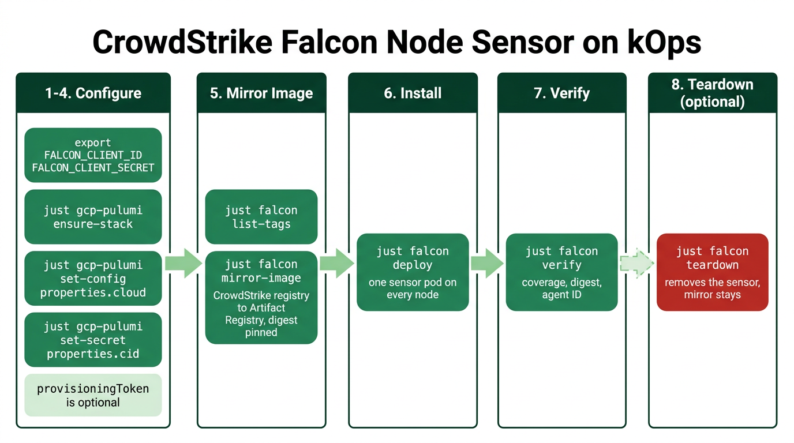

# Production CrowdStrike Falcon Sensor

This guide installs the **CrowdStrike Falcon node sensor** on a kOps cluster. It uses the `falcon-sensor` Helm chart **1.37.0** from `CrowdStrike/falcon-helm`. The sensor runs as a DaemonSet with one privileged pod on each node, the control plane included.

**Status**: Production procedure. Use `Pulumi.dcr-kube1.yaml` configs only.



## Table of Contents

- [Quick Reference](#quick-reference)
- [1. Prepare the Falcon API Client](#1-prepare-the-falcon-api-client)
- [2. Set the Falcon Cloud Region](#2-set-the-falcon-cloud-region)
- [3. Set the Customer ID](#3-set-the-customer-id)
- [4. Set the Provisioning Token](#4-set-the-provisioning-token)
- [5. Mirror the Sensor Image](#5-mirror-the-sensor-image)
- [6. Install the Sensor](#6-install-the-sensor)
- [7. Verify](#7-verify)
- [8. Teardown](#8-teardown)
- [9. Troubleshooting](#9-troubleshooting)
- [10. Related Documents](#10-related-documents)

---

## Quick Reference

For experienced users. Full details in sections below.

```bash
# Enter cluster environment first
just cluster-env --env prod --cluster <prod-cluster>

# 1. Export the Falcon API client (hidden prompts)
read -rs FALCON_CLIENT_ID && export FALCON_CLIENT_ID
read -rs FALCON_CLIENT_SECRET && export FALCON_CLIENT_SECRET

# 2. Initialize the stack, then set the Falcon cloud region of the tenant
just gcp-pulumi ensure-stack --folder falcon-sensor
just gcp-pulumi set-config --folder falcon-sensor --key properties.cloud --value <falcon-cloud>

# 3. Set the Customer ID with checksum (hidden prompt)
just gcp-pulumi set-secret --folder falcon-sensor --key properties.cid

# 5. List the tags, then mirror one tag into Artifact Registry
just falcon list-tags
just falcon mirror-image --tag <sensor-tag>

# 6. Install the sensor on every node
just falcon deploy

# 7. Verify
just falcon verify
```

Optional steps:
```bash
# 4. Provisioning token (only when the tenant requires one)
just gcp-pulumi set-secret --folder falcon-sensor --key properties.provisioningToken

# 8. Teardown (removes the sensor from every node)
just falcon teardown
```

---

**Everything below runs inside the cluster-env sub-shell.**

- Enter it with `just cluster-env --env prod --cluster <prod-cluster>`. The sub-shell exports `PULUMI_STACK`, `PROJECT_ID`, `GOOGLE_APPLICATION_CREDENTIALS`, `PULUMI_GCP_CREDENTIALS`, and `KUBECONFIG`.
- Recipes default `--stack` to `$PULUMI_STACK`, so no recipe below needs the flag.
- Outside the sub-shell, recipes fail with `Error: no stack name`.
- Leave the sub-shell with `exit` or Ctrl-D.

## 1. Prepare the Falcon API Client

Get a Falcon API client with the **Sensor Download: Read** and **Falcon Images Download: Read** scopes. Export its ID and secret in the cluster-env sub-shell. Recipes read them from the environment only.
→ [Prerequisite details](reference/falcon/prerequisites.md#falcon-api-client)

```bash
read -rs FALCON_CLIENT_ID && export FALCON_CLIENT_ID
read -rs FALCON_CLIENT_SECRET && export FALCON_CLIENT_SECRET
```

---

## 2. Set the Falcon Cloud Region

The Falcon cloud region identifies the CrowdStrike data center of the tenant. It is not the GCP region. The stack has no default value. Initialize the stack first.
→ [Region details](reference/falcon/prerequisites.md#falcon-cloud-region)

```bash
just gcp-pulumi ensure-stack --folder falcon-sensor
just gcp-pulumi set-config --folder falcon-sensor --key properties.cloud --value <falcon-cloud>
```

---

## 3. Set the Customer ID

The Customer ID (CID) with its checksum goes into the stack as a KMS-encrypted secret. `mirror-image` makes sure that the CID matches the tenant of the API client.
→ [Configuration details](reference/falcon/configure.md#customer-id)

```bash
just gcp-pulumi set-secret --folder falcon-sensor --key properties.cid
```

---

## 4. Set the Provisioning Token

**Optional. The default is off.** Set a token only when the tenant requires provisioning tokens for new hosts.
→ [Configuration details](reference/falcon/configure.md#provisioning-token)

```bash
just gcp-pulumi set-secret --folder falcon-sensor --key properties.provisioningToken
```

---

## 5. Mirror the Sensor Image

`mirror-image` copies one sensor tag from `registry.crowdstrike.com` into the project Artifact Registry. It gives the node service accounts read access and pins the digest in the stack config. The recipe accepts only versioned tags of 7.40 or later.
→ [Mirror details](reference/falcon/mirror-image.md)

```bash
just falcon list-tags
just falcon mirror-image --tag <sensor-tag>
```

---

## 6. Install the Sensor

`deploy` creates the `falcon-system` namespace, Secret `falcon-sensor-cid`, and the Helm release. It then waits until one sensor pod is ready on every node.
→ [Install details](reference/falcon/install.md)

```bash
just falcon deploy
```

---

## 7. Verify

Read-only checks: one ready pod on each node, the mirrored digest, and a Falcon agent ID in each pod. The command exits non-zero when a check fails.
→ [Verify details](reference/falcon/verify.md)

```bash
just falcon verify
```

---

## 8. Teardown

**Destructive. All nodes lose Falcon protection.** Teardown removes the Helm release, the Secret, and the namespace. The Artifact Registry mirror stays.
→ [Teardown details](reference/falcon/teardown.md)

```bash
just falcon teardown
```

---

## 9. Troubleshooting

→ [Full troubleshooting table](reference/falcon/troubleshooting.md)

---

## 10. Related Documents

**Reference details for this guide:**
- [Prerequisites](reference/falcon/prerequisites.md)
- [Configuration](reference/falcon/configure.md)
- [Mirror details](reference/falcon/mirror-image.md)
- [Install details](reference/falcon/install.md)
- [Teardown details](reference/falcon/teardown.md)
- [Verify details](reference/falcon/verify.md)
- [Troubleshooting](reference/falcon/troubleshooting.md)

**Other documentation:**
- Architecture: [`kops-gcp-architecture.md`](kops-gcp-architecture.md)
- Cluster bootstrap: [`kops-setup.md`](kops-setup.md)
- Pulumi backend: [`pulumi-setup.md`](pulumi-setup.md)
