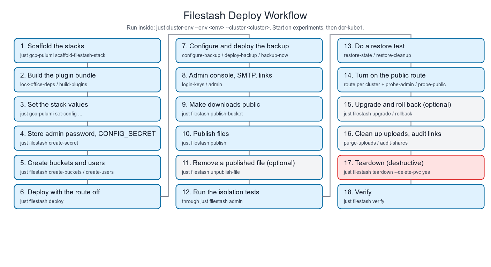

# Filestash File Manager Deploy

The `filestash/` Pulumi project deploys **Filestash** (`machines/filestash`), a web file manager, in front of the cluster MinIO. Outside collaborators upload files through private upload links into the private bucket `uploads`. The public browses the bucket `downloads` through one read-only Filestash link, and downloads each file from a direct MinIO URL such as `https://storage.dictycr.org/downloads/<dataset>/<file>`.
→ [Design](plans/2026-11-17-filestash-design.md)

**The project has two stack files.** `filestash/Pulumi.dcr-kube1.yaml` (namespace `prod`) uses a Gateway route. `filestash/Pulumi.experiments.yaml` (namespace `dev`) uses an nginx Ingress from this project, because that cluster has no Gateway stack. Start every rollout on `experiments`.

**Status**: Production procedure. Each stack file holds `<...>` placeholders and `backup.maxAgeHours: 0`. Validation rejects both, so a deploy cannot start until you set them.



## Table of Contents

- [Quick Reference](#quick-reference)
- [1. Scaffold the Stack](#1-scaffold-the-stack)
- [2. Create the Admin Secret](#2-create-the-admin-secret)
- [3. Create the Buckets and Users](#3-create-the-buckets-and-users)
- [4. Build the Plugin Bundle](#4-build-the-plugin-bundle)
- [5. Deploy with the Route Off](#5-deploy-with-the-route-off)
- [6. Configure the Admin Console, SMTP, and Links](#6-configure-the-admin-console-smtp-and-links)
- [7. Make the downloads Bucket Public](#7-make-the-downloads-bucket-public)
- [8. Publish Files](#8-publish-files)
- [9. Remove a Published File](#9-remove-a-published-file)
- [10. Turn On the Public Route](#10-turn-on-the-public-route)
- [11. Back Up and Restore the State](#11-back-up-and-restore-the-state)
- [12. Upgrade and Roll Back](#12-upgrade-and-roll-back)
- [13. Clean Up Uploads and Audit Links](#13-clean-up-uploads-and-audit-links)
- [14. Teardown](#14-teardown)
- [15. Verify](#15-verify)
- [16. Troubleshooting](#16-troubleshooting)
- [17. Related Documents](#17-related-documents)

---

## Quick Reference

For experienced users. Full details are in the sections below.

```bash
# Enter the cluster environment first
just cluster-env --env <env> --cluster <cluster>

# 1. Stack file (a new cluster only), then set host, maxAgeHours, and plugin pins
just gcp-pulumi scaffold-filestash-stack --state-size 5Gi --host <filestash-host>
# 2. Admin password (hidden prompt) and CONFIG_SECRET
just filestash create-secret
# 3. Buckets and the four MinIO users
just filestash create-buckets
just filestash create-users
# 4. Plugin bundle image; pin the printed tag and digest
just filestash build-plugins --tag <yyyy.mm.dd>
# 5. Deploy (route off)
just filestash deploy
# 6. Admin console through a port-forward: SMTP, upload links, public link
just filestash admin
# 7. Public read on downloads
just filestash publish-bucket
# 8. Publish reviewed uploads
just filestash publish --source <collaborator>/<path> --dataset <name>
# 10. Route on, then the admin probe from outside the cluster
just gateway deploy
just filestash probe-admin --host <filestash-host>
# 11. State copy and Velero backup (--velero-namespace when there is no install-velero stack file)
just filestash backup-now --velero-namespace <velero-ns>
# 15. Verify
just filestash verify --velero-namespace <velero-ns>
```

Optional steps:

```bash
# 9. Remove one published file
just filestash unpublish-file --key <dataset>/<file> --confirm yes
# 11. Restore test into a new isolated namespace
just filestash restore-state --velero-namespace <velero-ns> --backup <velero-backup> --target-namespace filestash-restore-test
# 12. Upgrade, and roll back
just filestash upgrade --velero-namespace <velero-ns> --tag <tag> --digest sha256:<digest>
just filestash rollback
# 13. Retention and link audit
just filestash purge-uploads --older-than <days>
just filestash audit-shares
# Grow the state PVC
just filestash resize-state --size <quantity>
# 14. Teardown (destructive: deletes every share link)
just filestash teardown --delete-pvc yes
```

---

**Everything below runs inside the cluster-env sub-shell.**

- Enter it with `just cluster-env --env <env> --cluster <cluster>`. The sub-shell exports `PULUMI_STACK`, `PULUMI_BACKEND_URL`, `PULUMI_GCP_CREDENTIALS`, and `KUBECONFIG`.
- Recipes default `--stack` to `$PULUMI_STACK` and `--namespace` to `properties.namespace` in `filestash/Pulumi.<stack>.yaml`.
- Outside the sub-shell, recipes fail with `Error: no stack name`.

## 1. Scaffold the Stack

Write `filestash/Pulumi.<stack>.yaml` from the cluster registry. The Ingress mode turns on only for a cluster with no `gateway/Pulumi.<stack>.yaml`. Then set the host, `backup.maxAgeHours`, and the remaining placeholders. Both current clusters have a committed stack file already.
→ [Install details](reference/filestash/install.md)

```bash
just gcp-pulumi scaffold-filestash-stack --state-size 5Gi --host <filestash-host>
```

---

## 2. Create the Admin Secret

Create Secret `filestash` with the bcrypt hash of the admin password and a random `CONFIG_SECRET`. A second run keeps `CONFIG_SECRET`.
→ [Install details](reference/filestash/install.md#just-filestash-create-secret)

```bash
just filestash create-secret
```

---

## 3. Create the Buckets and Users

Create the private bucket `uploads`, the bucket `downloads`, and the MinIO users `filestash-intake`, `filestash-public`, `filestash-operator`, and `filestash-publisher`. The keys go into Secret `filestash-users`.
→ [Users and policies](reference/filestash/users-and-policies.md)

```bash
just filestash create-buckets
just filestash create-users
```

---

## 4. Build the Plugin Bundle

Build `dictybase/filestash-plugins` from the lock files, then pin the printed tag and digest in the stack file. The build refuses to start until each lock entry has a checksum, a license, and a reviewer.
→ [Plugin details](reference/filestash/plugins.md)

```bash
just filestash build-plugins --tag <yyyy.mm.dd>
```

---

## 5. Deploy with the Route Off

Deploy one Filestash pod with its state PVC and the state backup CronJob. Keep the Gateway route off, or the Ingress host on the placeholder, until Section 10.
→ [Install details](reference/filestash/install.md#just-filestash-deploy)

```bash
just filestash deploy
```

---

## 6. Configure the Admin Console, SMTP, and Links

Open the admin console through a port-forward. Set SMTP, then make each upload link as `filestash-intake` and the public link as `filestash-public`.
→ [Links and SMTP](reference/filestash/shares.md)

```bash
just filestash admin
```

---

## 7. Make the downloads Bucket Public

Set anonymous `s3:GetObject` on `downloads/*`. Anonymous list stays denied, and `uploads` stays private.
→ [Users and policies](reference/filestash/users-and-policies.md#bucket-policy)

```bash
just filestash publish-bucket
```

---

## 8. Publish Files

Copy reviewed files from `uploads/<source>/` to `downloads/<dataset>/`. The recipe refuses to replace a file and prints each direct URL.
→ [Publish details](reference/filestash/publish.md)

```bash
just filestash publish --source <collaborator>/<path> --dataset <name>
```

---

## 9. Remove a Published File

**Optional.** Delete one object from `downloads`. Its direct URL then returns 404.
→ [Publish details](reference/filestash/publish.md#just-filestash-unpublish-file)

```bash
just filestash unpublish-file --key <dataset>/<file> --confirm yes
```

---

## 10. Turn On the Public Route

Turn on the route, add the DNS `A` record, and run the admin probe from outside the cluster. If the probe fails, turn the route off again.
→ [Admin access and route](reference/filestash/admin-access.md)

```bash
# Gateway clusters (dcr-kube1): route in the gateway stack
just gcp-pulumi set-config --folder gateway --key properties.routes.filestash.hosts.0 --value <filestash-host>
just gcp-pulumi set-config --folder gateway --key properties.routes.filestash.enabled --value true
just gateway deploy
# Ingress clusters (experiments): the host is in the filestash stack
just gcp-pulumi set-config --folder filestash --key properties.ingress.hosts.0 --value <filestash-host>
just filestash deploy
# Both, after DNS resolves
just filestash probe-admin --host <filestash-host>
```

---

## 11. Back Up and Restore the State

The CronJob copies the state every 4 hours. Make a copy and a Velero backup now, then do a restore test into a new isolated namespace.
→ [Backup and restore](reference/filestash/backup-restore.md)

```bash
just filestash backup-now --velero-namespace <velero-ns>
just filestash restore-state --velero-namespace <velero-ns> --backup <velero-backup> --target-namespace filestash-restore-test
just filestash restore-cleanup --target-namespace filestash-restore-test
```

---

## 12. Upgrade and Roll Back

**Optional.** Upgrade makes a backup first and saves the current image for rollback.
→ [Operations](reference/filestash/operations.md#just-filestash-upgrade)

```bash
just filestash upgrade --velero-namespace <velero-ns> --tag <tag> --digest sha256:<digest>
```

---

## 13. Clean Up Uploads and Audit Links

**Optional.** List or delete old uploads, and check every share link against the rules.
→ [Operations](reference/filestash/operations.md#just-filestash-purge-uploads)

```bash
just filestash purge-uploads --older-than <days>
just filestash audit-shares
```

---

## 14. Teardown

**Destructive.** Deletes the state PVC: `config.json`, every share link, and the state copies. The buckets stay.
→ [Operations](reference/filestash/operations.md#just-filestash-teardown)

```bash
just filestash teardown --delete-pvc yes
```

---

## 15. Verify

Read-only checks: rollout, PVC use, plugins, browser shell off, bucket policies, and the age of the state copy and the Velero backup.
→ [Verify details](reference/filestash/verify.md)

```bash
just filestash verify --velero-namespace <velero-ns>
```

---

## 16. Troubleshooting

→ [Full troubleshooting table](reference/filestash/troubleshooting.md)

---

## 17. Related Documents

- [Design](plans/2026-11-17-filestash-design.md) and [implementation plan](plans/2026-11-17-filestash-implementation.md)
- [Install details](reference/filestash/install.md)
- [Users and policies](reference/filestash/users-and-policies.md)
- [Plugin details](reference/filestash/plugins.md)
- [Links and SMTP](reference/filestash/shares.md)
- [Publish details](reference/filestash/publish.md)
- [Admin access and route](reference/filestash/admin-access.md)
- [Backup and restore](reference/filestash/backup-restore.md)
- [Operations](reference/filestash/operations.md)
- [Verify details](reference/filestash/verify.md)
- [Image facts](reference/filestash/image-facts.md)
- [MinIO Deploy Guide](minio-deploy.md) and [Gateway Deploy Guide](gateway-deploy.md)
