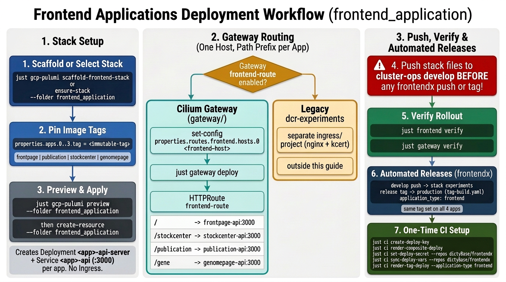

# Frontend Applications Deploy

The `frontend_application/` Pulumi project deploys the four dictyBase web front ends into one namespace: **frontpage** (`dictybase/dicty-frontpage`), **publication**, **stockcenter** (`dictybase/stock-center`), and **genomepage**. For each app the project creates the Deployment `<app>-api-server` and the Service `<app>-api` on port `3000`. The project passes no arguments, no environment variables, and no Secret to the containers, so each image must hold its own configuration.

**The project creates no Ingress.** The central Cilium Gateway ([`gateway-deploy.md`](gateway-deploy.md)) routes the external traffic on one hostname, with a path prefix for each app. The legacy `nginx` Ingress project (`ingress/`) exists on `dcr-experiments` only.

**Status**: Production procedure. Run `just gcp-pulumi scaffold-frontend-stack` to create a new cluster stack file from the registry and template, or `just gcp-pulumi ensure-stack --folder frontend_application` when the stack file already exists.



## Table of Contents

- [Quick Reference](#quick-reference)
- [1. Scaffold or Select the Stack](#1-scaffold-or-select-the-stack)
- [2. Pin the Image Tags](#2-pin-the-image-tags)
- [3. Preview and Deploy](#3-preview-and-deploy)
- [4. Expose Through the Production Gateway](#4-expose-through-the-production-gateway)
- [5. Push the Stack Files](#5-push-the-stack-files)
- [6. Verify the Rollout](#6-verify-the-rollout)
- [7. Enable Production Tag Deploys](#7-enable-production-tag-deploys)
  - [7.1 Create the Deployer Key](#71-create-the-deployer-key)
  - [7.2 Prepare the Composite Deploy Workflow](#72-prepare-the-composite-deploy-workflow)
  - [7.3 Publish CI Credentials and Variables](#73-publish-ci-credentials-and-variables)
  - [7.4 Render the Tag Workflow and Open the Pull Request](#74-render-the-tag-workflow-and-open-the-pull-request)
- [8. Troubleshooting](#8-troubleshooting)
- [9. Related Documents](#9-related-documents)

---

## Quick Reference

For experienced users. Full details in the sections below.

```bash
# Enter the cluster environment first
just cluster-env --env <env> --cluster <cluster>

# 1. Scaffold the stack file on a new cluster, or select an existing stack
just gcp-pulumi scaffold-frontend-stack
just gcp-pulumi ensure-stack --folder frontend_application

# 2. Pin an immutable develop-<sha> or release tag for each app (replace 'bootstrap')
just gcp-pulumi set-config --folder frontend_application --key properties.apps.0.tag --value <frontpage-tag>
just gcp-pulumi set-config --folder frontend_application --key properties.apps.1.tag --value <publication-tag>
just gcp-pulumi set-config --folder frontend_application --key properties.apps.2.tag --value <stockcenter-tag>
just gcp-pulumi set-config --folder frontend_application --key properties.apps.3.tag --value <genomepage-tag>

# 3. Read the plan, then apply it
just gcp-pulumi preview --folder frontend_application
just gcp-pulumi create-resource --folder frontend_application

# 4. Set the public hostname, then deploy the Gateway route
just gcp-pulumi set-config --folder gateway --key properties.routes.frontend.hosts.0 --value <frontend-host>
just gateway deploy

# 5. Push the stack files
git add "frontend_application/Pulumi.${PULUMI_STACK}.yaml" "gateway/Pulumi.${PULUMI_STACK}.yaml" && git commit -m "frontend_application: stack config" && git push

# 6. Verify the rollout
just frontend verify
just gateway verify

# 7. Optional, one time per cluster. Let release tags deploy.
just ci create-deploy-key
just ci render-composite-deploy
just ci set-deploy-secret --repos dictyBase/frontendx
just ci sync-deploy-vars --repos dictyBase/frontendx
just frontend pr-deploy-workflow
```

---

**All of the commands below run in the cluster-env sub-shell.**

- Enter the sub-shell with `just cluster-env --env <env> --cluster <cluster>`. The sub-shell reads `.env.<env>.<cluster>` and exports `PULUMI_STACK`, `PULUMI_BACKEND_URL`, `PULUMI_GCP_CREDENTIALS`, `PROJECT_ID`, and `KUBECONFIG`.
- Each recipe defaults `--stack` to `$PULUMI_STACK`. No command below needs the flag.
- Outside the sub-shell the recipes fail with `Error: no stack name`.
- Leave the sub-shell with `exit` or Ctrl-D.

## 1. Scaffold or Select the Stack

On a new cluster, run `scaffold-frontend-stack` to initialize the stack with the cluster KMS key and render `frontend_application/Pulumi.${PULUMI_STACK}.yaml` from `config/templates/frontend-stack.yaml.tmpl`. The template lists four apps, each with `tag: bootstrap`. When the stack file already exists, run `ensure-stack` to select the stack.
→ [Create the stack](reference/frontend/deployment.md#create-the-stack)

```bash
# New cluster (creates the stack and writes frontend_application/Pulumi.${PULUMI_STACK}.yaml)
just gcp-pulumi scaffold-frontend-stack

# Existing stack file
just gcp-pulumi ensure-stack --folder frontend_application
```

---

## 2. Pin the Image Tags

Replace each `bootstrap` placeholder with an immutable `develop-<sha>` tag or a release tag. Index `0` to `3` selects the app in the stack file order: `frontpage`, `publication`, `stockcenter`, `genomepage`.
→ [Image tags](reference/frontend/deployment.md#image-tags)

```bash
just gcp-pulumi set-config --folder frontend_application --key properties.apps.0.tag --value <frontpage-tag>
just gcp-pulumi set-config --folder frontend_application --key properties.apps.1.tag --value <publication-tag>
just gcp-pulumi set-config --folder frontend_application --key properties.apps.2.tag --value <stockcenter-tag>
just gcp-pulumi set-config --folder frontend_application --key properties.apps.3.tag --value <genomepage-tag>
```

---

## 3. Preview and Deploy

Read the plan, then apply it. The apply is not interactive, and it stops by itself when the plan changes a protected resource. For an upgrade, change the tag of one app and run both commands again.
→ [Deploy behavior](reference/frontend/deployment.md#deploy-behavior)

```bash
just gcp-pulumi preview --folder frontend_application
just gcp-pulumi create-resource --folder frontend_application
```

---

## 4. Expose Through the Production Gateway

The `frontend-route` in the `gateway/` stack sends `/`, `/stockcenter`, `/publication`, and `/gene` to the four Services. Set the public hostname, then deploy the Gateway. Deploy `frontend_application` first, because the route needs the four Services. **If the hostname already resolves to another IP address, read the cutover steps before you change DNS.**
→ [Hostname cutover](reference/frontend/deployment.md#reuse-a-hostname-from-another-cluster) · [Frontend route](reference/gateway/deployment.md#frontend-route) · [Routing](reference/frontend/deployment.md#routing)

```bash
just gcp-pulumi set-config --folder gateway --key properties.routes.frontend.hosts.0 --value <frontend-host>
just gateway deploy
```

---

## 5. Push the Stack Files

**CAUTION: Push cluster-ops `develop` before you push `dictyBase/frontendx` `develop` or cut a tag.** CI clones cluster-ops at `develop`, so a stack file that you did not push deploys nothing.
→ [Stack files](reference/frontend/deployment.md#stack-files)

```bash
git add "frontend_application/Pulumi.${PULUMI_STACK}.yaml" "gateway/Pulumi.${PULUMI_STACK}.yaml" && git commit -m "frontend_application: stack config" && git push
```

---

## 6. Verify the Rollout

For each app in the stack file, the recipe checks the Deployment rollout, the running image against `properties.apps.<index>.tag`, and the Service. The Gateway check passes only after the DNS record resolves.
→ [Verification](reference/frontend/deployment.md#verification)

```bash
just frontend verify
just gateway verify
```

---

## 7. Enable Production Tag Deploys

**Optional. Do this one time for each cluster. Skip it while production deploys stay manual.**

**CAUTION: A production tag build bakes the `.env.production` URLs of `frontendx` into the images.** Those URLs name the lab hosts, not the production hosts. Fix them in `frontendx` before you cut the first production tag.
→ [Baked-in endpoints](reference/frontend/deployment.md#baked-in-endpoints)

A push to `develop` in `dictyBase/frontendx` already deploys the lab `experiments` stack. These steps add a release-tag deploy to the production cluster. The monorepo builds all four images and sets the same tag on all four apps. `frontendx` is not listed in `config/services.yaml`, so `just ci deploy-backend-services` and `just ci pr-deploy-workflows` do not cover it. Run the four steps below.
→ [CI deployment](reference/frontend/deployment.md#ci-deployment) · [Tag deploy setup](reference/frontend/deployment.md#tag-deploy-setup)

### 7.1 Create the Deployer Key

Create or reuse the cluster deployer service account and key at `credentials/<cluster>/deployer.json`, and run the read-only credential preflight. If a backend guide already ran this step, the recipe reuses the key file.
→ [Deploy credential details](reference/backend/ci-credentials.md)

```bash
just ci create-deploy-key
```

### 7.2 Prepare the Composite Deploy Workflow

Publish the organization variable `PROD_PULUMI_STATE_STORAGE` and render `bin/ci-render/composite-deploy.yaml`. If `dictyBase/workflows` already has this change on `develop`, the recipe reports that no pull request is needed.
→ [Workflow render details](reference/backend/render-deploy-workflows.md)

```bash
just ci render-composite-deploy
```

### 7.3 Publish CI Credentials and Variables

Give `dictyBase/frontendx` access to `PROD_DEPLOY_SA_KEY`, and publish the five `PROD_*` repository variables from `config/clusters/<cluster>.yaml`.
→ [CI variables details](reference/backend/ci-variables.md) · [Tag deploy setup](reference/frontend/deployment.md#tag-deploy-setup)

```bash
just ci set-deploy-secret --repos dictyBase/frontendx
just ci sync-deploy-vars --repos dictyBase/frontendx
```

### 7.4 Render the Tag Workflow and Open the Pull Request

Render `bin/ci-render/frontendx-tag-build.yaml` (`runner: dcr-frontendx-prod`), update `runner: dcr-frontendx-beefy` in `.github/workflows/ci.yml`, update the production URLs in `apps/*/.env.production` from `gateway/Pulumi.${PULUMI_STACK}.yaml`, and open a pull request on `dictyBase/frontendx`. The recipe leaves `.env.development` untouched, so `develop` pushes keep targeting `experiments`.
→ [Tag deploy setup](reference/frontend/deployment.md#tag-deploy-setup) · [Workflow render details](reference/backend/render-deploy-workflows.md#render-tag-deploy-flags)

```bash
just frontend pr-deploy-workflow
```

---

## 8. Troubleshooting

→ [Troubleshooting table](reference/frontend/deployment.md#troubleshooting)

---

## 9. Related Documents

**Reference details for this guide:**
- [Frontend applications deployment details](reference/frontend/deployment.md)

**Other documents:**
- Gateway routing (`gateway/`): [`gateway-deploy.md`](gateway-deploy.md)
- GraphQL server behind the front ends: [`graphql-deploy.md`](graphql-deploy.md)
- Cluster registry (`config/clusters/<cluster>.yaml`): [`reference/backend/cluster-registry.md`](reference/backend/cluster-registry.md)
- CI credentials and variables: [`reference/backend/ci-credentials.md`](reference/backend/ci-credentials.md), [`reference/backend/ci-variables.md`](reference/backend/ci-variables.md)
- Shared namespaces: [`reference/pulumi/namespaces.md`](reference/pulumi/namespaces.md)
