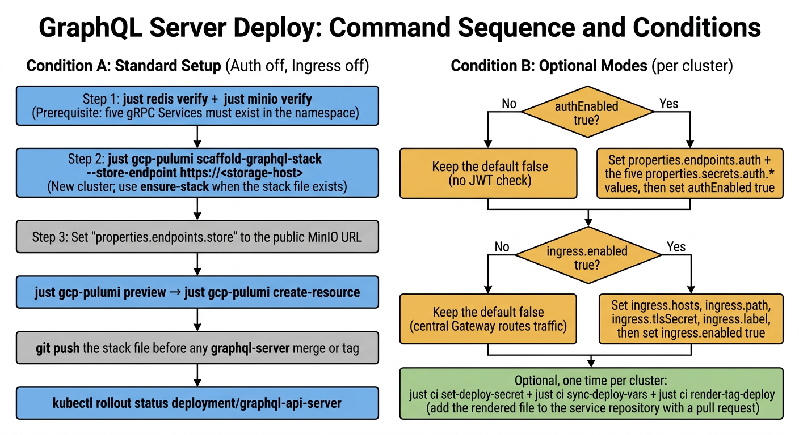

# GraphQL Server Deploy

The `graphql_server/` Pulumi project deploys **graphql-server** (`dictybase/graphql-server`) into one namespace. The project creates the Deployment `graphql-api-server` and the NodePort Service `graphql-api` on port `8080`. The server reads from Redis, MinIO, and five in-cluster gRPC Services.

**The per-app TLS Ingress is optional, and it is off by default.** With the default, the stack creates the Deployment and the Service only, and a central Gateway routes the external traffic. [Section 5](#5-configure-ingress-mode-optional) gives the procedure to turn the Ingress on.

**Status**: Production procedure. Run `just gcp-pulumi scaffold-graphql-stack` to create a new cluster stack file from the registry and template, or `just gcp-pulumi ensure-stack --folder graphql_server` when the stack file already exists.



## Table of Contents

- [Quick Reference](#quick-reference)
- [1. Verify the Upstream Services](#1-verify-the-upstream-services)
- [2. Scaffold or Select the Stack](#2-scaffold-or-select-the-stack)
- [3. Configure the Storage Endpoint](#3-configure-the-storage-endpoint)
- [4. Configure Authentication Mode](#4-configure-authentication-mode)
- [5. Configure Ingress Mode (Optional)](#5-configure-ingress-mode-optional)
- [6. Configure NCBI Credentials (Optional)](#6-configure-ncbi-credentials-optional)
- [7. Preview and Deploy](#7-preview-and-deploy)
- [8. Push the Stack File](#8-push-the-stack-file)
- [9. Verify the Rollout](#9-verify-the-rollout)
- [10. Enable Production Tag Deploys](#10-enable-production-tag-deploys)
- [11. Troubleshooting](#11-troubleshooting)
- [12. Related Documents](#12-related-documents)

---

## Quick Reference

For experienced users. Full details in the sections below.

```bash
# Enter the cluster environment first
just cluster-env --env <env> --cluster <cluster>

# 1. Verify the datastores. The five gRPC Services must also exist.
just redis verify
just minio verify

# 2. Scaffold the stack file on a new cluster, or select an existing stack
just gcp-pulumi scaffold-graphql-stack --store-endpoint https://<storage-host>
just gcp-pulumi ensure-stack --folder graphql_server

# 3. Set the public S3 storage endpoint URL
just gcp-pulumi set-config --folder graphql_server --key properties.endpoints.store --value https://<storage-host>

# 4. Set the authentication mode. The default is false.
just gcp-pulumi set-config --folder graphql_server --key properties.authEnabled --value false

# 5. Optional. Set the Ingress mode. The default is false (no Ingress).
just gcp-pulumi set-config --folder graphql_server --key properties.ingress.enabled --value false

# 6. Optional. Give the publication fetch an NCBI API key. The default is no key.
just gcp-pulumi set-secret --folder graphql_server --key properties.secrets.ncbi.values.apiKey
just gcp-pulumi set-secret --folder graphql_server --key properties.secrets.ncbi.values.email
just gcp-pulumi set-secret --folder graphql_server --key properties.secrets.ncbi.values.tool

# 7. Read the plan, then apply it
just gcp-pulumi preview --folder graphql_server
just gcp-pulumi create-resource --folder graphql_server

# 8. Push the stack file before each graphql-server merge or tag
git add "graphql_server/Pulumi.${PULUMI_STACK}.yaml" && git commit -m "graphql_server: stack config" && git push

# 9. Verify the rollout. The sub-shell sets no default namespace.
kubectl -n <namespace> rollout status deployment/graphql-api-server

# 10. Optional, one time per cluster. Let release tags deploy.
just ci set-deploy-secret --repos dictyBase/graphql-server
just ci sync-deploy-vars --repos dictyBase/graphql-server
just ci render-tag-deploy --app graphql-server --project graphql_server --out bin/ci-render/graphql-server-tag-build.yaml
```

---

**All of the commands below run in the cluster-env sub-shell.**

- Enter the sub-shell with `just cluster-env --env <env> --cluster <cluster>`. The sub-shell reads `.env.<env>.<cluster>` and exports `PULUMI_STACK`, `PULUMI_BACKEND_URL`, `PULUMI_GCP_CREDENTIALS`, `PROJECT_ID`, and `KUBECONFIG`.
- Each recipe defaults `--stack` to `$PULUMI_STACK`. No command below needs the flag.
- Outside the sub-shell the recipes fail with `Error: no stack name`.
- Leave the sub-shell with `exit` or Ctrl-D.

## 1. Verify the Upstream Services

Redis, MinIO, and the five modware gRPC Services must exist in the namespace before the pod starts. Kubernetes gives the `*_SERVICE_HOST` variables only to a pod that starts after the Service, and the container exits when one variable is absent.
→ [Prerequisites](reference/graphql/deployment.md#prerequisites) · [Service discovery](reference/graphql/deployment.md#in-cluster-service-discovery)

```bash
just redis verify
just minio verify
```

---

## 2. Scaffold or Select the Stack

On a new cluster, run `scaffold-graphql-stack` to initialize the stack with the cluster KMS key and render `graphql_server/Pulumi.${PULUMI_STACK}.yaml` from `config/templates/graphql-stack.yaml.tmpl`. Pass `--store-endpoint` with the cluster's public MinIO URL (otherwise the recipe writes the lab default `https://storage.dictybase.dev`). When the stack file already exists, run `ensure-stack` to select the stack.
→ [Create the stack](reference/graphql/deployment.md#create-the-stack)

```bash
# New cluster (creates the stack and writes graphql_server/Pulumi.${PULUMI_STACK}.yaml)
just gcp-pulumi scaffold-graphql-stack --store-endpoint https://<storage-host>

# Existing stack file
just gcp-pulumi ensure-stack --folder graphql_server
```

---

## 3. Configure the Storage Endpoint

Set `properties.endpoints.store` to the public HTTPS URL of the cluster's MinIO service (for example, `https://slimestorage.dictycr.org`). Pulumi passes this value to `--s3-storage-api`, which the server uses to construct public asset URLs for uploaded files (`<store>/<s3Bucket.name>/<s3Bucket.path>/<file>`).
→ [Storage endpoint](reference/graphql/deployment.md#storage-endpoint)

```bash
just gcp-pulumi set-config --folder graphql_server --key properties.endpoints.store --value https://<storage-host>
```

---

## 4. Configure Authentication Mode

The key `properties.authEnabled` defaults to `false`, and the server then accepts each request without a JWT. To use Logto, set `properties.endpoints.auth` and the five `properties.secrets.auth.*` values first. Then set the key to `true`.
→ [Authentication mode](reference/graphql/deployment.md#authentication-mode)

```bash
# Keep authentication off (default)
just gcp-pulumi set-config --folder graphql_server --key properties.authEnabled --value false

# Turn authentication on. Set the endpoint and the five secrets first.
just gcp-pulumi set-config --folder graphql_server --key properties.endpoints.auth --value <logto-url>
just gcp-pulumi set-secret --folder graphql_server --key properties.secrets.auth.appId
just gcp-pulumi set-secret --folder graphql_server --key properties.secrets.auth.appSecret
just gcp-pulumi set-secret --folder graphql_server --key properties.secrets.auth.jwksURI
just gcp-pulumi set-secret --folder graphql_server --key properties.secrets.auth.jwtIssuer
just gcp-pulumi set-secret --folder graphql_server --key properties.secrets.auth.jwtAudience
just gcp-pulumi set-config --folder graphql_server --key properties.authEnabled --value true
```

---

## 5. Configure Ingress Mode (Optional)

**Optional. The default is off. Skip this section to keep the Ingress off.**

The key `properties.ingress.enabled` defaults to `false`. With `false`, the stack creates the Deployment and the Service only, and a central Gateway routes the external traffic. To create the per-app `nginx` Ingress `graphql-ingress`, set `hosts`, `path`, `tlsSecret`, and `label` first. Then set the key to `true`.
→ [Ingress mode](reference/graphql/deployment.md#ingress-mode)

```bash
# Keep the Ingress off (default). You can also do nothing and omit the key.
just gcp-pulumi set-config --folder graphql_server --key properties.ingress.enabled --value false

# Turn the Ingress on. Set the four keys first.
just gcp-pulumi set-config --folder graphql_server --key properties.ingress.hosts.0 --value <graphql-host>
just gcp-pulumi set-config --folder graphql_server --key properties.ingress.path --value /
just gcp-pulumi set-config --folder graphql_server --key properties.ingress.tlsSecret --value <graphql-tls-secret>
just gcp-pulumi set-config --folder graphql_server --key properties.ingress.label.name --value kcert.dev/ingress
just gcp-pulumi set-config --folder graphql_server --key properties.ingress.label.value --value managed
just gcp-pulumi set-config --folder graphql_server --key properties.ingress.enabled --value true
```

---

## 6. Configure NCBI Credentials (Optional)

**Optional. The default is off. Skip this section to keep the server without an NCBI API key.**

The three `properties.secrets.ncbi.values.*` keys are empty by default. With the default, the stack creates no NCBI Secret, and the publication fetch calls NCBI without an API key. NCBI then limits each client address to a low request rate and can answer a burst with HTTP 429. To use a key, set all three values: the API key, the contact email, and the tool name. NCBI asks each client to send the email and the tool name, so the stack and the server reject a partial set. The tool name must not contain spaces. The image must be a build that reads `NCBI_API_KEY`, `NCBI_EMAIL`, and `NCBI_TOOL`.
→ [NCBI credentials](reference/graphql/deployment.md#ncbi-credentials)

```bash
# Keep the key off (default). Do nothing.

# Turn the key on. Enter each value at the hidden prompt.
just gcp-pulumi set-secret --folder graphql_server --key properties.secrets.ncbi.values.apiKey
just gcp-pulumi set-secret --folder graphql_server --key properties.secrets.ncbi.values.email
just gcp-pulumi set-secret --folder graphql_server --key properties.secrets.ncbi.values.tool
```

---

## 7. Preview and Deploy

Read the plan, then apply it. The apply is not interactive, and it stops by itself when the plan changes a protected resource. For an upgrade, change `properties.image.tag` and run both commands again.
→ [Deploy behavior](reference/graphql/deployment.md#deploy-behavior)

```bash
just gcp-pulumi preview --folder graphql_server
just gcp-pulumi create-resource --folder graphql_server
```

---

## 8. Push the Stack File

**CAUTION: Push cluster-ops `develop` before you merge or tag `dictyBase/graphql-server`.** CI clones cluster-ops at `develop`, so a stack file that you did not push deploys nothing.
→ [CI deployment](reference/graphql/deployment.md#ci-deployment)

```bash
git add "graphql_server/Pulumi.${PULUMI_STACK}.yaml" && git commit -m "graphql_server: stack config" && git push
```

---

## 9. Verify the Rollout

No recipe covers this project, so use `kubectl`. The sub-shell sets no default namespace, so give `-n <namespace>` with the value of `properties.namespace`.
→ [Verification](reference/graphql/deployment.md#verification)

```bash
kubectl -n <namespace> rollout status deployment/graphql-api-server
```

---

## 10. Enable Production Tag Deploys

**Optional. Do this one time for each cluster. Skip it while production deploys stay manual.**

These three recipes give `dictyBase/graphql-server` access to `PROD_DEPLOY_SA_KEY`, publish the `<CI_ENV>_*` repository variables, and render a tag workflow file. The rendered file does nothing until you add it to the service repository with a pull request.
→ [Tag deploy setup](reference/graphql/deployment.md#tag-deploy-setup)

```bash
just ci set-deploy-secret --repos dictyBase/graphql-server
just ci sync-deploy-vars --repos dictyBase/graphql-server
just ci render-tag-deploy --app graphql-server --project graphql_server --out bin/ci-render/graphql-server-tag-build.yaml
```

---

## 11. Troubleshooting

→ [Troubleshooting table](reference/graphql/deployment.md#troubleshooting)

---

## 12. Related Documents

**Reference details for this guide:**
- [GraphQL server deployment details](reference/graphql/deployment.md)

**Other documents:**
- Gateway routing (`gateway/`): [`gateway-deploy.md`](gateway-deploy.md)
- gRPC backends behind this server: [`backend-service-deploy.md`](backend-service-deploy.md)
- Redis: [`redis-deploy.md`](redis-deploy.md)
- MinIO and the asset bucket: [`minio-deploy.md`](minio-deploy.md)
- Logto, for `authEnabled: true` only: [`logto-deploy.md`](logto-deploy.md)
- Shared namespaces: [`reference/pulumi/namespaces.md`](reference/pulumi/namespaces.md)
