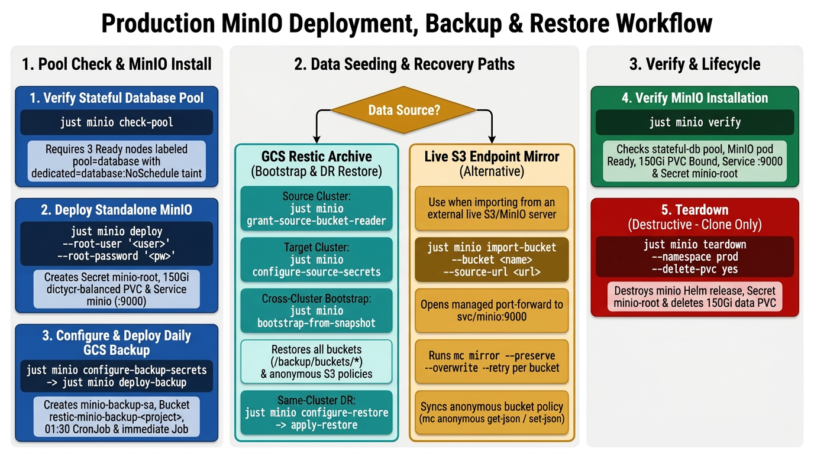

# Production MinIO on the Stateful Database Pool

Provisioning guide for production **standalone MinIO** (S3 API, Bitnami chart 17) on kOps `stateful-db`.

**Status**: Production procedure. Use `Pulumi.dcr-kube1.yaml` configs only. Do not edit the lab `dev`/`experiments`/`local` stacks of `minio`.



## Table of Contents

- [Quick Reference](#quick-reference)
- [1. Pool Check](#1-pool-check)
- [2. Install MinIO](#2-install-minio)
- [3. Import Data](#3-import-data)
  - [3.1 Bootstrap from a Source Cluster's GCS Backup](#31-bootstrap-from-a-source-clusters-gcs-backup)
  - [3.2 Alternative: Mirror Directly from a Live S3 Endpoint](#32-alternative-mirror-directly-from-a-live-s3-endpoint)
- [4. Backup & Restore](#4-backup--restore)
- [5. Teardown](#5-teardown)
- [6. Verify](#6-verify)
- [7. Troubleshooting](#7-troubleshooting)
- [8. Related Documents](#8-related-documents)

---

## Quick Reference

For experienced users. Full details are in the sections below.

```bash
# Enter cluster environment first
just cluster-env --env prod --cluster <prod-cluster>

# 1. Verify the stateful-db pool
just minio check-pool

# 2. Deploy standalone MinIO (single pod, PVC on dictycr-balanced)
just minio deploy --root-user '<user>' --root-password '<password>'

# 3.1 Bootstrap from a source cluster's GCS restic backup bucket
just minio configure-source-secrets \
  --restic-password '<source-restic-pass>' \
  --gcs-project <source-project-id> \
  --gcs-key-file credentials/<source-project-id>/minio-restic-reader.json
just minio bootstrap-from-snapshot \
  --namespace prod \
  --bucket restic-minio-backup-<source-project-id>

# 4. Configure and deploy daily GCS backup (01:30 CronJob + immediate Job)
just minio configure-backup-secrets --restic-password '<restic-pass>'
just minio deploy-backup

# 6. Verify installation
just minio verify
```

Optional steps:
```bash
# 3.2 Alternative: mirror one bucket directly from a live S3/MinIO endpoint
just minio import-bucket \
  --bucket <bucket> \
  --source-url <https://source-endpoint:9000> \
  --source-user '<source-access-key>' \
  --source-password '<source-secret-key>'

# Same-cluster DR restore from gs://restic-minio-backup-<project-id>
just minio configure-restore --namespace prod
just minio apply-restore

# Teardown (clone only, destructive — deletes the data PVC = all objects)
just minio teardown --namespace prod --delete-pvc yes
```

---

**Everything below runs inside the cluster-env sub-shell.**

- Enter it with `just cluster-env --env prod --cluster <prod-cluster>`. The sub-shell sources `.env.prod.<prod-cluster>` and exports `PULUMI_STACK`, `PULUMI_BACKEND_URL`, `PULUMI_GCP_CREDENTIALS`, `PROJECT_ID`, and `KUBECONFIG`.
- Recipes default `--stack` to `$PULUMI_STACK`, so no recipe below needs the flag.
- Outside the sub-shell recipes fail with `Error: no stack name`.
- Leave the sub-shell with `exit` or Ctrl-D.

## 1. Pool Check

Verify 3 Ready nodes labeled `pool=database` with the `dedicated=database:NoSchedule` taint. The pod carries a matching nodeSelector + toleration — it stays Pending without them.
→ [Pool requirements](reference/minio/pool-requirements.md)

```bash
just minio check-pool
```

---

## 2. Install MinIO

Creates the root-credentials Secret `minio-root` and installs the Bitnami MinIO chart **17.0.21** from `oci://registry-1.docker.io/bitnamicharts` — image `bitnamilegacy/minio:2025.7.23-debian-12-r3` — in standalone mode with a 150Gi `dictycr-balanced` PVC.
→ [Install details](reference/minio/install.md) · [address and credentials](reference/minio/install.md#service-and-credentials) · [no HA](reference/minio/install.md#no-ha)

```bash
just minio deploy --root-user '<user>' --root-password '<password>'
```

---

## 3. Import Data

`deploy` leaves MinIO running and **empty**. Seed it either from a source cluster's GCS `restic` backup ([Section 3.1](#31-bootstrap-from-a-source-clusters-gcs-backup)) or directly from a live S3 endpoint ([Section 3.2](#32-alternative-mirror-directly-from-a-live-s3-endpoint)).

### 3.1 Bootstrap from a Source Cluster's GCS Backup

Grant read access to the source MinIO backup bucket from the **source** cluster shell, then return to **this** cluster's shell to restore all buckets and their anonymous policies from `gs://restic-minio-backup-<source-project-id>`.
→ [Restore and bootstrap details](reference/minio/restore.md#cross-cluster-bootstrap-cloning-from-a-source-clusters-gcs-backup)

**In the SOURCE cluster sub-shell:**

```bash
exit
just cluster-env --env <source-env> --cluster <source-cluster>
just minio grant-source-bucket-reader
just minio source-secret-value --namespace prod
```

---

**In THIS cluster's sub-shell:**

```bash
exit
just cluster-env --env prod --cluster <prod-cluster>
just minio configure-source-secrets \
  --restic-password '<source-restic-pass>' \
  --gcs-project <source-project-id> \
  --gcs-key-file credentials/<source-project-id>/minio-restic-reader.json
just minio bootstrap-from-snapshot \
  --namespace prod \
  --bucket restic-minio-backup-<source-project-id>
```

### 3.2 Alternative: Mirror Directly from a Live S3 Endpoint

**Optional. Use this path when importing from an S3 endpoint that does not have a GCS `restic` backup archive.**

Mirrors one bucket per run and its anonymous policy from a live MinIO or S3 endpoint with `mc mirror`.
→ [Import details](reference/minio/import.md) · [idempotence](reference/minio/import.md#idempotence)

```bash
just minio import-bucket \
  --bucket <bucket> \
  --source-url <https://source-endpoint:9000> \
  --source-user '<source-access-key>' \
  --source-password '<source-secret-key>'
```

---

## 4. Backup & Restore

Daily **01:30** `restic` backup of all MinIO buckets and anonymous policies to `gs://restic-minio-backup-<project-id>` through the `minio-backup-sa` identity, plus an immediate first run. For same-cluster disaster recovery (`configure-restore` + `apply-restore`), refer to the restore reference.
→ [Backup details](reference/minio/backup.md) · [Restore details](reference/minio/restore.md)

```bash
just minio configure-backup-secrets --restic-password '<restic-pass>'
just minio deploy-backup
```

---

## 5. Teardown

**Destructive. Clone only.** Deletes the data PVC — every object in every bucket.
→ [Teardown details](reference/minio/teardown.md)

```bash
just minio teardown --namespace prod --delete-pvc yes
```

---

## 6. Verify

Read-only checks: pool node count, MinIO pod, PVC, Service on 9000, Secret. Exits non-zero if any check fails.
→ [Verify details](reference/minio/verify.md)

```bash
just minio verify
```

---

## 7. Troubleshooting

→ [Full troubleshooting table](reference/minio/troubleshooting.md)

---

## 8. Related Documents

**Reference details for this guide:**
- [Pool requirements](reference/minio/pool-requirements.md)
- [Install details](reference/minio/install.md)
- [Backup details](reference/minio/backup.md)
- [Restore and bootstrap details](reference/minio/restore.md)
- [Direct S3 import details](reference/minio/import.md)
- [Teardown details](reference/minio/teardown.md)
- [Verify details](reference/minio/verify.md)
- [Troubleshooting](reference/minio/troubleshooting.md)

**Other documentation:**
- Gateway routing (`gateway/`): [`gateway-deploy.md`](gateway-deploy.md)
- PostgreSQL on the same pool: [`postgres-deploy.md`](postgres-deploy.md)
- ArangoDB on the same pool: [`arangodb-deploy.md`](arangodb-deploy.md)
- Redis on the same pool: [`redis-deploy.md`](redis-deploy.md)
- Declarative cluster clone: [`cluster-clone.md`](cluster-clone.md)
- Architecture: [`kops-gcp-architecture.md`](kops-gcp-architecture.md)
- Cluster bootstrap: [`kops-setup.md`](kops-setup.md)
- Pulumi backend + StorageClass: [`pulumi-setup.md`](pulumi-setup.md)
