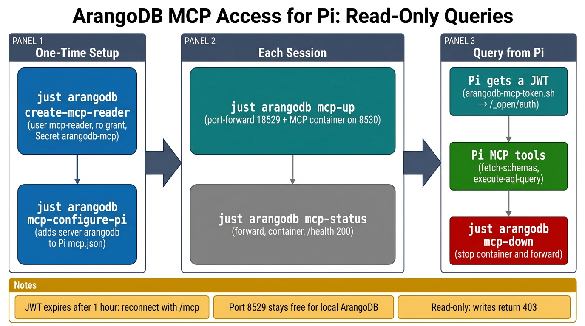

# ArangoDB MCP Access Details

Back to: [ArangoDB Deploy Guide](../../arangodb-deploy.md)

This document explains how Pi queries the cluster ArangoDB through the `arangodb/mcp-arangodb` server as a read-only user.

## Table of Contents

- [How It Works](#how-it-works)
- [Create the Reader (`create-mcp-reader`)](#create-the-reader-create-mcp-reader)
- [Start and Stop (`mcp-up`, `mcp-down`, `mcp-status`)](#start-and-stop-mcp-up-mcp-down-mcp-status)
- [Register in Pi (`mcp-configure-pi`)](#register-in-pi-mcp-configure-pi)
  - [Access From Other Folders](#access-from-other-folders)
- [Troubleshooting](#troubleshooting)

---

## How It Works

The MCP server runs on your workstation in Docker. Pi connects to it through local ports.

| Port | Listener | Used by |
|---|---|---|
| `18529` | Port-forward to Service `arangodb` | MCP container and the token script |
| `8530` | MCP server (HTTP mode) | Pi |

Each Pi connection gets a JWT for user `mcp-reader` from `/_open/auth`. The MCP server runs every query with that JWT, so every query has read-only access. A JWT expires after about one hour. Reconnect with `/mcp` to get a new JWT.

---

## Create the Reader (`create-mcp-reader`)

### What It Does

Creates user `mcp-reader` with grant `ro` on every application database. Stack `<PULUMI_STACK>-mcp-reader` of project `create-arangodb-databases` owns Secret `arangodb-mcp`.

### Behavior

1. Checks the kubeconfig, credentials, stack config, namespace, and root Secret before the first change.
2. Asks for the password at a hidden prompt when `--reader-password` is not given. The password must have at least 16 characters and differ from the root and application passwords.
3. Stores the password as encrypted stack config, then runs preview and update.
4. Waits for the Job that creates the user and grants `ro`.
5. Logs in as `mcp-reader` and confirms that a write attempt fails.

### Flags

| Flag | Required | Default | Notes |
|---|---|---|---|
| `--reader-password` / `-p` | No | Hidden prompt | Rerun with a new value to rotate the password |
| `--namespace` / `-n` | No | Stack config `namespace` | A mismatch stops the recipe |
| `--stack` / `-s` | No | `$PULUMI_STACK` | The recipe appends `-mcp-reader` |

---

## Start and Stop (`mcp-up`, `mcp-down`, `mcp-status`)

`mcp-up` checks that the kubeconfig client certificate is valid for at least one hour. Then it starts the port-forward and the MCP container, and waits for `/health` to return 200. After the first connection, the port-forward retries network drops until the kubeconfig certificate expires. State goes to `~/.local/state/arangodb-mcp/`, outside the repository. The directory has mode 0700, and the `reader.env` file has mode 0600.

| Flag | Required | Default | Notes |
|---|---|---|---|
| `--namespace` / `-n` | No | Stack config `namespace` | |
| `--database` / `-d` | No | First configured database | Tools accept other databases by name |
| `--forward-port` / `-p` | No | `$ARANGODB_MCP_FORWARD_PORT`, else `18529` | Port `8529` is free for a local ArangoDB container |

`mcp-down` removes the container, stops the forward, and empties the state directory. The empty directory stays because the nono profile grants it. `mcp-status` shows the forward, the container, and the `/health` result.

---

## Register in Pi (`mcp-configure-pi`)

Adds server `arangodb` to `~/.pi/agent/mcp.json` and keeps the other servers. The recipe installs `scripts/arangodb-mcp-token.sh` as `~/bin/arangodb-mcp-token`. The `Authorization` header runs that copy. The recipe also creates the empty state directory. Run the recipe again after a change to the token script. Then start a new Pi session.

### Access From Other Folders

The token script reads only `~/.local/state/arangodb-mcp/`. Pi in any folder can use the server without access to the `cluster-ops` repository. The repository holds kubeconfigs and deploy keys, so do not grant it to other sessions.

The base nono profile `pi` gives these grants:

| Grant | Value |
|---|---|
| Read | `~/.local/state/arangodb-mcp` |
| Open port | `8530` (MCP server) |
| Open port | `18529` (forward for the JWT login) |

A forward port other than `18529` needs a matching `open_port` grant.

---

## Troubleshooting

| Symptom | Cause | Fix |
|---|---|---|
| `kubeconfig client certificate ... is expired` | The kOps admin certificate expired | Run `just gcp-cluster export-kubeconfig`, then run `just arangodb mcp-up` |
| `local port <n> is in use` | Another listener on the port | Use `--forward-port`, or stop the other listener |
| `/mcp` shows no `arangodb` server | The session started before registration | Start a new Pi session |
| Tool calls return `401` | JWT expired | Reconnect the server with `/mcp` |
| `MCP server state is missing` | `mcp-up` is not running | Run `just arangodb mcp-up` |
| Token script fails in another folder | The Pi profile has no grant for the state directory or the ports | Start Pi with the `pi` profile that has the [grants](#access-from-other-folders) |
| Preview fails with `must be no more than 63 characters` | Long Secret name in the Job name | Keep Secret name `arangodb-mcp` |
