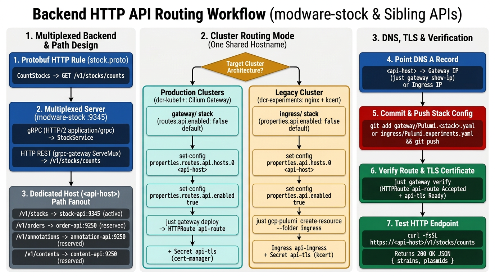

# Backend HTTP API Routing Details

Back to: [Backend Service Deploy Guide](../../backend-service-deploy.md)

This document describes how to expose the `grpc-gateway` HTTP endpoints of the `modware-*` backend Services on one dedicated hostname across production Gateway clusters (`dcr-kube1` and new clusters) and the legacy `dcr-experiments` Ingress cluster.

## Table of Contents

- [Architecture: Multiplexed Port and Path-Prefix Routing](#architecture-multiplexed-port-and-path-prefix-routing)
- [Routing Modes by Cluster](#routing-modes-by-cluster)
- [Production Clusters: Cilium Gateway](#production-clusters-cilium-gateway)
- [Legacy dcr-experiments: nginx Ingress](#legacy-dcr-experiments-nginx-ingress)
- [Add Future HTTP APIs to the Shared Hostname](#add-future-http-apis-to-the-shared-hostname)
- [Verification](#verification)

---

## Architecture: Multiplexed Port and Path-Prefix Routing



`modware-stock` implements the HTTP rules declared in `dictybase/stock/stock.proto` (`GET /v1/stocks/counts`) through an in-memory `grpc-gateway` mux multiplexed on the same TCP port (`9345`) as the gRPC server:

- **gRPC traffic**: HTTP/2 requests with `Content-Type: application/grpc` go to the gRPC server (`StockService`).
- **HTTP REST traffic**: HTTP/1.1 and HTTP/2 requests with standard HTTP content types go to the `grpc-gateway` mux (`GET /v1/stocks/counts`).
- **Kubernetes `Service`**: `stock-api` exposes port `9345` as standard `ClusterIP` TCP, so both `nginx` `Ingress` and Cilium `HTTPRoute` forward HTTP requests directly to `stock-api:9345` without a separate port or sidecar proxy.

All public HTTP APIs share **one dedicated hostname** (`<api-host>`) and route by versioned resource prefix (`PathPrefix` / `Prefix`) without URL path rewrite rules:

| Path Prefix | Backend Service | Port | Status | Endpoints |
|-------------|-----------------|------|--------|-----------|
| `/v1/stocks` | `stock-api` | `9345` | Active (`modware-stock`) | `GET /v1/stocks/counts` and future `/v1/stocks/...` routes |
| `/v1/orders` | `order-api` | `9250` | Reserved for future HTTP rules | Future `/v1/orders/...` routes |
| `/v1/annotations` | `annotation-api` | `9250` | Reserved for future HTTP rules | Future `/v1/annotations/...` routes |
| `/v1/contents` | `content-api` | `9250` | Reserved for future HTTP rules | Future `/v1/contents/...` routes |

Because each service owns its `/v1/<resource>` prefix in its protobuf HTTP annotations, the Gateway or Ingress forwards the original request path unchanged.

---

## Routing Modes by Cluster

The `modware-*` Pulumi projects (`internal/backend`) create only the `Deployment` (`<app>-api-server`) and the `Service` (`<app>-api`). External HTTP routing lives in the cluster routing stack so backend service stacks stay identical across clusters:

| Cluster Type | Target Clusters | Pulumi Stack | Kubernetes Resource | Default Toggle | TLS Certificate Manager |
|--------------|-----------------|--------------|---------------------|----------------|-------------------------|
| **Production (Recommended)** | `dcr-kube1` and new clusters | `gateway/` ([`gateway-deploy.md`](../../gateway-deploy.md)) | Cilium `Gateway` `dictycr-gateway` + `HTTPRoute` `api-route` | `properties.routes.api.enabled: false` | `cert-manager` (`Issuer` `letsencrypt-issuer` → Secret `api-tls`) |
| **Legacy** | `dcr-experiments` (`experiments` stack) | `ingress/` | `nginx` `Ingress` `api-ingress` | `properties.api.enabled: false` | `kcert` (`kcert.dev/ingress: managed` → Secret `api-tls`) |

---

## Production Clusters: Cilium Gateway

On `dcr-kube1` and new clusters, `gateway/Pulumi.<stack>.yaml` (rendered from `config/templates/gateway-stack.yaml.tmpl`) includes the `routes.api` block with `enabled: false` and `stock-api:9345` pre-populated under `services`:

```yaml
      api:
        enabled: false
        hosts:
          - <api-host>
        tlsSecret: api-tls
        services:
          - name: stock-api
            path: /v1/stocks
            port: 9345
```

After `modware-stock` is deployed in the namespace, enable the route in the target cluster's `cluster-env` sub-shell ([Gateway HTTP API route](../gateway/deployment.md#http-api-route)):

```bash
just gcp-pulumi set-config --folder gateway --key properties.routes.api.hosts.0 --value <api-host>
just gcp-pulumi set-config --folder gateway --key properties.routes.api.enabled --value true
just gateway deploy
```

Point the DNS `A` record for `<api-host>` to the external IP address printed by `just gateway show-ip`, then run `just gateway verify` to confirm that `HTTPRoute` `api-route` is `Accepted` and `cert-manager` has issued TLS Secret `api-tls`.

---

## Legacy dcr-experiments: nginx Ingress

On `dcr-experiments` (`experiments` stack), `ingress/Pulumi.experiments.yaml` defines the `api` block alongside `frontend` with `enabled: false` by default:

```yaml
    api:
      enabled: false
      hosts:
        - <api-host>
      label:
        name: kcert.dev/ingress
        value: managed
      secret: api-tls
      services:
        - name: stock-api
          path: /v1/stocks
          port: 9345
```

When `properties.api.enabled` is `true`, `ingress/` creates `Ingress` `api-ingress` (`ingressClassName: nginx`) in namespace `dev` with label `kcert.dev/ingress: managed` so `kcert` issues the production Let's Encrypt certificate into Secret `api-tls`.

**Run in the `dcr-experiments` `cluster-env` sub-shell (`just cluster-env --env dev --cluster dcr-experiments`):**

```bash
just gcp-pulumi ensure-stack --folder ingress
just gcp-pulumi set-config --folder ingress --key properties.api.hosts.0 --value <api-host>
just gcp-pulumi set-config --folder ingress --key properties.api.enabled --value true
just gcp-pulumi preview --folder ingress
just gcp-pulumi create-resource --folder ingress
```

---

## Add Future HTTP APIs to the Shared Hostname

When another `modware-*` service adds `google.api.http` annotations under its `/v1/<resource>` prefix (for example, `/v1/orders` on `order-api:9250`), append a new entry to the `services` list on the same `<api-host>`:

**On production clusters (`gateway/` stack):**

```bash
just gcp-pulumi set-config --folder gateway --key properties.routes.api.services.1.name --value order-api
just gcp-pulumi set-config --folder gateway --key properties.routes.api.services.1.path --value /v1/orders
just gcp-pulumi set-config --folder gateway --key properties.routes.api.services.1.port --value 9250
just gateway deploy
```

**On `dcr-experiments` (`ingress/` stack):**

```bash
just gcp-pulumi set-config --folder ingress --key properties.api.services.1.name --value order-api
just gcp-pulumi set-config --folder ingress --key properties.api.services.1.path --value /v1/orders
just gcp-pulumi set-config --folder ingress --key properties.api.services.1.port --value 9250
just gcp-pulumi preview --folder ingress
just gcp-pulumi create-resource --folder ingress
```

---

## Verification

After DNS resolves and the TLS certificate is ready, query the stock counts HTTP endpoint:

```bash
curl -fsSL "https://<api-host>/v1/stocks/counts"
```

Expected response shape (`200 OK`, `application/json`):

```json
{
  "strains": {
    "total": "...",
    "subtypes": [...]
  },
  "plasmids": {
    "total": "...",
    "subtypes": [...]
  }
}
```
