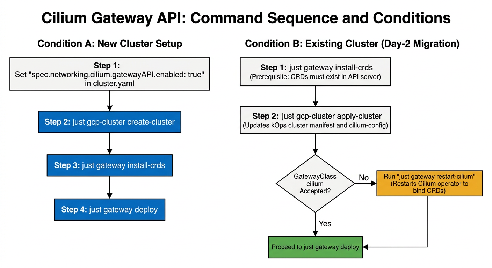

# Gateway Deployment Details

Back to: [Gateway Deploy Guide](../../gateway-deploy.md)

This document gives the details for the `gateway/` Pulumi project and the `just gateway` recipes: the resources, the Cilium and `cert-manager` prerequisites, the recipes and flags, the stack configuration, the per-route toggles, the TLS certificate flow, the verification checks, and the troubleshooting table.

## Table of Contents

- [What the Project Creates](#what-the-project-creates)
- [Prerequisites](#prerequisites)
  - [Command Sequences and Dependencies](#command-sequences-and-dependencies)
- [Recipes](#recipes)
  - [just gateway install-crds](#just-gateway-install-crds)
  - [just gateway restart-cilium](#just-gateway-restart-cilium)
  - [just gcp-pulumi scaffold-gateway-stack](#just-gcp-pulumi-scaffold-gateway-stack)
  - [just gateway check](#just-gateway-check)
  - [just gateway deploy](#just-gateway-deploy)
  - [just gateway show-ip](#just-gateway-show-ip)
  - [just gateway verify](#just-gateway-verify)
- [Create the Stack](#create-the-stack)
- [Configure the ACME Issuer](#configure-the-acme-issuer)
- [Configure the Routes](#configure-the-routes)
  - [Frontend Route](#frontend-route)
  - [GraphQL Route](#graphql-route)
  - [MinIO Route](#minio-route)
  - [Logto Route](#logto-route)
- [TLS Certificate Issuance](#tls-certificate-issuance)
- [Verification](#verification)
- [Troubleshooting](#troubleshooting)

---

## What the Project Creates

The `gateway/` Pulumi project creates the ACME `Issuer`, the Cilium `Gateway`, and one `HTTPRoute` for each enabled service in the application namespace.

| Order | Resource | Default Name | Details |
|-------|----------|--------------|---------|
| 1 | `cert-manager.io/v1:Issuer` | `letsencrypt-issuer` | ACME HTTP-01 solver that attaches challenge `HTTPRoute` resources to `Gateway` `dictycr-gateway`. |
| 2 | `gateway.networking.k8s.io/v1:Gateway` | `dictycr-gateway` | Class `cilium`. Annotated with `cert-manager.io/issuer: letsencrypt-issuer`. Carries one HTTP listener on port `80` and one HTTPS listener on port `443` for each host on an enabled route. |
| 3 | `gateway.networking.k8s.io/v1:HTTPRoute` | `frontend-route` | **Optional (`routes.frontend.enabled: true` by default).** Routes `/`, `/stockcenter`, `/publication`, and `/gene` to the four frontend Services on port `3000`. |
| 4 | `gateway.networking.k8s.io/v1:HTTPRoute` | `graphql-route` | **Optional (`routes.graphql.enabled: true` by default).** Routes `/` (both the GraphiQL playground at `/` and queries at `/graphql`) to Service `graphql-api` on port `8080`. |
| 5 | `gateway.networking.k8s.io/v1:HTTPRoute` | `minio-route` | **Optional (`routes.minio.enabled: true` by default).** Routes `/` to Service `minio` on port `9000`. |
| 6 | `gateway.networking.k8s.io/v1:HTTPRoute` | `logto-route` | **Optional (`routes.logto.enabled: false` by default).** Routes `/` to Service `logto-api` on port `3001`. |

The project creates **no Namespace** and **no backend Service**. The `namespace-bootstrap` stack owns the namespace ([shared namespaces](../pulumi/namespaces.md)). The legacy `ingress/`, `ingress-controller/`, `redirect-ingress/`, `kcert/`, and `cert-issuer/` projects remain for the lab `dcr-experiments` cluster only.

---

## Prerequisites

Each component in the table below must be ready before you deploy the Gateway stack.

| Component | Requirement | Check | Guide |
|-----------|-------------|-------|-------|
| Cluster shell | Active `cluster-env` sub-shell | `echo "$PULUMI_STACK"` | [`pulumi-setup.md`](../../pulumi-setup.md) |
| Shared namespaces | `namespace-bootstrap` applied (`appNamespace` matches `properties.namespace`) | `pulumi -C namespace-bootstrap stack output appNamespace` | [`pulumi-setup.md`](../../pulumi-setup.md) |
| Cilium Gateway API | `spec.networking.cilium.gatewayAPI.enabled: true` in `config/kops/<cluster>/cluster.yaml` | `kubectl get gatewayclass cilium` | [`kops-setup.md`](../../kops-setup.md) |
| Gateway API CRDs | Standard install bundle (`gateways`, `httproutes`, `gatewayclasses`, `referencegrants`) | `just gateway install-crds` | This guide |
| `cert-manager` | Running with `--enable-gateway-api` on the controller container | `just gateway install-crds` | [`kops-setup.md`](../../kops-setup.md) |
| Backend Services | Every Service referenced by an enabled route exists in the namespace | `just gateway check` | [`graphql-deploy.md`](../../graphql-deploy.md), [`minio-deploy.md`](../../minio-deploy.md), [`logto-deploy.md`](../../logto-deploy.md) |

On an existing kOps cluster where `spec.networking.cilium.gatewayAPI.enabled: true` was added to `config/kops/<cluster>/cluster.yaml`, follow the sequence in [Command Sequences and Dependencies](#command-sequences-and-dependencies) to make sure that the CRDs exist before Cilium reconciles.

### Command Sequences and Dependencies



Cilium creates `GatewayClass` `cilium` only when two conditions are true:
1. The Gateway API CRDs exist in the Kubernetes API server.
2. The Cilium operator runs with Gateway API enabled in its configuration.

Follow the sequence that matches your cluster state:

#### Condition 1: New Cluster

1. Enable Cilium Gateway API in `config/kops/<cluster>/cluster.yaml`:
   ```yaml
   spec:
     networking:
       cilium:
         gatewayAPI:
           enabled: true
   ```
2. Provision the cluster:
   ```bash
   just gcp-cluster create-cluster
   ```
3. Install Gateway API CRDs and enable Gateway API on `cert-manager`:
   ```bash
   just gateway install-crds
   ```
4. Restart Cilium so the operator and node agents bind the Gateway API CRDs:
   ```bash
   just gateway restart-cilium
   ```
5. Deploy the Gateway:
   ```bash
   just gateway deploy
   ```

#### Condition 2: Existing Cluster (Migration to Gateway API)

1. Install the CRDs into the API server before you update the cluster:
   ```bash
   just gateway install-crds
   ```
   **Dependency**: The Gateway API CRDs must exist in the API server before the controller can register `GatewayClass` `cilium`.
2. Apply the updated cluster manifest to reconcile `cilium-config`:
   ```bash
   just gcp-cluster apply-cluster
   ```
   **Dependency**: This step pushes `spec.networking.cilium.gatewayAPI.enabled: true` to the state store and updates ConfigMap `cilium-config` in `kube-system`.
3. If `GatewayClass` `cilium` is not accepted, restart the Cilium operator:
   ```bash
   just gateway restart-cilium
   ```
   **Dependency**: When Cilium was already active before the update, the operator must restart to bind the CRDs and register `GatewayClass` `cilium`.
4. Deploy the Gateway:
   ```bash
   just gateway deploy
   ```

---

## Recipes

### just gateway install-crds

Applies the Kubernetes Gateway API standard CRD bundle and enables `--enable-gateway-api` on the `cert-manager` Deployment if the flag is absent.

```bash
just gateway install-crds
```

Behavior:

1. Validates that `--version` matches `v<major>.<minor>.<patch>`.
2. Runs `kubectl apply -f https://github.com/kubernetes-sigs/gateway-api/releases/download/<version>/standard-install.yaml`.
3. Verifies that `gateways.gateway.networking.k8s.io` and `httproutes.gateway.networking.k8s.io` exist.
4. Locates Deployment `cert-manager` in `kube-system` or `cert-manager`. If `--enable-gateway-api` is not present in the container arguments, patches the Deployment to append `--enable-gateway-api` and waits for the rollout.

| Flag | Required | Default | Notes |
|------|----------|---------|-------|
| `--version` / `-v` | No | `v1.2.1` | Gateway API release tag |

### just gateway restart-cilium

Restarts the Cilium operator and Cilium agent pods in `kube-system`, waits for their rollouts, and verifies that `GatewayClass` `cilium` exists and is `Accepted`.

```bash
just gateway restart-cilium
```

Behavior:

1. Validates that `--retries` and `--interval` are positive integers.
2. Restarts Deployment `cilium-operator` in namespace `kube-system`.
3. If DaemonSet `cilium` uses strategy `RollingUpdate`, restarts the DaemonSet and waits for its rollout. If DaemonSet `cilium` uses strategy `OnDelete` (the kOps default), deletes each `k8s-app=cilium` pod one node at a time and waits for the replacement pod on that node to report `Ready` so every node agent activates `CiliumEnvoyConfig`.
4. Waits for `rollout status` on `deployment/cilium-operator`.
5. Polls `kubectl get gatewayclass <class> -o json` until condition `Accepted=True` or until retries expire.

| Flag | Required | Default | Notes |
|------|----------|---------|-------|
| `--class` / `-c` | No | `cilium` | Target GatewayClass name |
| `--retries` / `-r` | No | `18` | Poll attempts |
| `--interval` / `-i` | No | `5` | Seconds between polls (90s default budget) |

### just gcp-pulumi scaffold-gateway-stack

Initializes the stack with the cluster KMS key and renders `gateway/Pulumi.<stack>.yaml` from `config/templates/gateway-stack.yaml.tmpl` and the cluster registry entry (`config/clusters/<cluster>.yaml`).

```bash
just gcp-pulumi scaffold-gateway-stack
```

Behavior:

1. Reads `namespace` and `kms_secrets_provider` from the registry entry matching `--stack` (`$PULUMI_STACK`).
2. Refuses to overwrite an existing `gateway/Pulumi.<stack>.yaml`.
3. Runs `pulumi -C gateway stack init <stack> --secrets-provider <kms>` and appends the rendered `config:` block.
4. Validates that `name` is `dictycr-gateway`, `gatewayClassName` is `cilium`, and `namespace` matches the registry.

| Flag | Required | Default | Notes |
|------|----------|---------|-------|
| `--stack` / `-s` | No | `$PULUMI_STACK` | Must match a `stack:` key in `config/clusters/*.yaml` |

### just gateway check

Read-only preflight gate. Creates and applies nothing.

```bash
just gateway check
```

Behavior:

1. Requires `PULUMI_BACKEND_URL`, `PULUMI_GCP_CREDENTIALS`, and `PULUMI_SECRET_PROVIDER` to be non-empty, and the credentials file to exist.
2. Requires `gateway/Pulumi.<stack>.yaml` to exist, and `yq` on `PATH`.
3. Checks that `name` and `gatewayClassName` are non-empty, `namespace` equals `--namespace`, and `issuer.email` and `issuer.secretName` are non-empty and contain no `<` or `>` placeholders.
4. Checks each route (`frontend`, `graphql`, `minio`, `logto`). For every route where `enabled` is `true`, requires every entry in `hosts` and the `tlsSecret` to be non-empty and free of `<` or `>` placeholders. Requires at least one route to have `enabled: true`.
5. Reads `pulumi -C namespace-bootstrap stack output appNamespace` and requires it to equal `--namespace`.
6. Verifies that `GatewayClass` `cilium` exists and reports condition `Accepted=True`.
7. For each enabled route, verifies that the target Kubernetes `Service` (`frontpage-api`, `stockcenter-api`, `publication-api`, `genomepage-api`, `graphql-api`, `minio`, or `logto-api`) exists in `--namespace`.

| Flag | Required | Default | Notes |
|------|----------|---------|-------|
| `--stack` / `-s` | No | `$PULUMI_STACK` | No `dev` fallback |
| `--namespace` / `-n` | No | `prod` | Must match the `namespace-bootstrap` `appNamespace` export |

### just gateway deploy

Composite deployment command. Runs preflight, stack selection, preview, apply, and waits for Cilium to assign an external IP address to the `Gateway`. Does not check TLS Secrets yet because you must point DNS `A` records at the new external IP address before `cert-manager` can complete HTTP-01 challenges.

```bash
just gateway deploy
```

Behavior:

1. `just gateway check --stack <stack> --namespace <ns>`
2. `just gcp-pulumi ensure-stack --folder gateway --stack <stack>`
3. `just gcp-pulumi preview --folder gateway --stack <stack>`
4. `just gcp-pulumi create-resource --folder gateway --stack <stack>`
5. Polls `Gateway` `<name>` until `.status.addresses[0].value` is non-empty and prints the external IP address.

| Flag | Required | Default | Notes |
|------|----------|---------|-------|
| `--stack` / `-s` | No | `$PULUMI_STACK` | Passed to all steps |
| `--namespace` / `-n` | No | `prod` | Target namespace |
| `--retries` / `-r` | No | `30` | External IP poll attempts |
| `--interval` / `-i` | No | `10` | Seconds between external IP polls (300s default budget) |

### just gateway show-ip

Prints the external LoadBalancer IP address assigned to the `Gateway`.

```bash
just gateway show-ip
```

| Flag | Required | Default | Notes |
|------|----------|---------|-------|
| `--stack` / `-s` | No | `$PULUMI_STACK` | Reads `properties.name` from `gateway/Pulumi.<stack>.yaml` |
| `--namespace` / `-n` | No | `prod` | Target namespace |

### just gateway verify

Read-only health check for the deployed `Issuer`, `Gateway`, `HTTPRoute` resources, and TLS Secrets.

```bash
just gateway verify
```

| Flag | Required | Default | Notes |
|------|----------|---------|-------|
| `--stack` / `-s` | No | `$PULUMI_STACK` | Reads expected names and enabled routes from `gateway/Pulumi.<stack>.yaml` |
| `--namespace` / `-n` | No | `prod` | Target namespace |

---

## Create the Stack

Run `scaffold-gateway-stack` on a new cluster to create `gateway/Pulumi.<stack>.yaml`:

```bash
just gcp-pulumi scaffold-gateway-stack
```

When `gateway/Pulumi.<stack>.yaml` already exists in Git, select the stack with:

```bash
just gcp-pulumi ensure-stack --folder gateway
```

### Baseline Stack File

The scaffold template writes this configuration block. Replace `<acme-email>` and the `<...-host>` placeholders for each enabled route with `just gcp-pulumi set-config` before you run `just gateway check` or `just gateway deploy`.

```yaml
config:
  gateway:properties:
    name: dictycr-gateway
    namespace: prod
    gatewayClassName: cilium
    issuer:
      name: letsencrypt-issuer
      email: <acme-email>
      server: https://acme-v02.api.letsencrypt.org/directory
      secretName: letsencrypt-account-key
    routes:
      frontend:
        enabled: true
        hosts:
          - <frontend-host>
        tlsSecret: frontend-tls
        services:
          - name: frontpage-api
            path: /
            port: 3000
          - name: stockcenter-api
            path: /stockcenter
            port: 3000
          - name: publication-api
            path: /publication
            port: 3000
          - name: genomepage-api
            path: /gene
            port: 3000
      graphql:
        enabled: true
        hosts:
          - <graphql-host>
        tlsSecret: graphql-tls
        serviceName: graphql-api
        servicePort: 8080
        path: /
      minio:
        enabled: true
        hosts:
          - <minio-host>
        tlsSecret: minio-tls
        serviceName: minio
        servicePort: 9000
        path: /
      logto:
        enabled: false
        hosts:
          - <logto-host>
        tlsSecret: logto-tls
        serviceName: logto-api
        servicePort: 3001
        path: /
```

**Keep all hostnames, service names, and TLS Secret names in plain text.** None of these values is a credential. `just gateway check` and `just gateway verify` inspect `gateway/Pulumi.<stack>.yaml` with `yq`.

---

## Configure the ACME Issuer

The `issuer` block configures the namespace-scoped `cert-manager.io/v1` `Issuer`.

| Key | Default | Purpose |
|-----|---------|---------|
| `properties.issuer.name` | `letsencrypt-issuer` | Name of the `Issuer` resource and value of the `cert-manager.io/issuer` annotation on the `Gateway`. |
| `properties.issuer.email` | `<acme-email>` (required) | Contact email for Let's Encrypt registration and expiry notices. |
| `properties.issuer.server` | `https://acme-v02.api.letsencrypt.org/directory` | ACME directory URL. |
| `properties.issuer.secretName` | `letsencrypt-account-key` | Kubernetes Secret where `cert-manager` stores the generated ACME account private key. |

Set the contact email with:

```bash
just gcp-pulumi set-config --folder gateway --key properties.issuer.email --value <acme-email>
```

---

## Configure the Routes

Each route block has an `enabled` boolean. When `enabled` is `true`, the program adds an HTTPS listener on port `443` of the `Gateway` for each unique hostname (deduplicating when two routes, such as `frontend` and `graphql`, share the same hostname and TLS Secret) and creates `<route>-route`. When `enabled` is `false`, the program skips both the listener and the `HTTPRoute`, and ignores any `<...-host>` placeholder on that route. At least one route must have `enabled: true`.

### Frontend Route

`properties.routes.frontend.enabled` defaults to **`true`** in the scaffold template. When enabled, `frontend-route` routes the four path prefixes of `frontend_application` on one hostname:

| Path Prefix | Backend Service | Port |
|-------------|-----------------|------|
| `/` | `frontpage-api` | `3000` |
| `/stockcenter` | `stockcenter-api` | `3000` |
| `/publication` | `publication-api` | `3000` |
| `/gene` | `genomepage-api` | `3000` |

Set the public frontend hostname (`set-config` rewrites `hosts.0` to `hosts[0]` so `zsh` does not expand `[0]` as a filename pattern):

```bash
just gcp-pulumi set-config --folder gateway --key properties.routes.frontend.hosts.0 --value <frontend-host>
just gcp-pulumi set-config --folder gateway --key properties.routes.frontend.enabled --value true
```

If `frontend_application` is not deployed on the cluster yet, turn the route off until the four Services exist:

```bash
just gcp-pulumi set-config --folder gateway --key properties.routes.frontend.enabled --value false
```

### GraphQL Route

`properties.routes.graphql.enabled` defaults to **`true`** and `properties.routes.graphql.path` defaults to **`/`** in the scaffold template. When enabled, `graphql-route` routes `/` (`PathPrefix`, covering both the GraphiQL playground at `/` and queries at `/graphql`) to `graphql-api:8080`. Keep `properties.ingress.enabled` set to `false` in `graphql_server/Pulumi.<stack>.yaml` ([GraphQL deploy](../../graphql-deploy.md)).

```bash
just gcp-pulumi set-config --folder gateway --key properties.routes.graphql.hosts.0 --value <graphql-host>
just gcp-pulumi set-config --folder gateway --key properties.routes.graphql.enabled --value true
```

### MinIO Route

`properties.routes.minio.enabled` defaults to **`true`** in the scaffold template. When enabled, `minio-route` routes `/` (`PathPrefix`) to `minio:9000`. Keep `properties.apiIngress.enabled` set to `false` in `minio/Pulumi.<stack>.yaml` ([MinIO deploy](../../minio-deploy.md)).

```bash
just gcp-pulumi set-config --folder gateway --key properties.routes.minio.hosts.0 --value <minio-host>
just gcp-pulumi set-config --folder gateway --key properties.routes.minio.enabled --value true
```

### Logto Route

`properties.routes.logto.enabled` defaults to **`false`** in the scaffold template. When enabled, `logto-route` routes `/` (`PathPrefix`) to `logto-api:3001` (`logto-admin:3002` stays internal). Keep `properties.ingress.enabled` set to `false` in `log-to/Pulumi.<stack>.yaml` ([Logto deploy](../../logto-deploy.md)).

Turn the Logto route on after `log-to` is deployed:

```bash
just gcp-pulumi set-config --folder gateway --key properties.routes.logto.hosts.0 --value <logto-host>
just gcp-pulumi set-config --folder gateway --key properties.routes.logto.enabled --value true
```

---

## TLS Certificate Issuance

1. Cilium provisions a GCP LoadBalancer for `Gateway` `dictycr-gateway` and writes the external IP address to `status.addresses[0].value`.
2. Point the DNS A records for each enabled route hostname (`<frontend-host>`, `<graphql-host>`, `<minio-host>`, `<logto-host>`) at that external IP address.
3. Because `dictycr-gateway` carries the annotation `cert-manager.io/issuer: letsencrypt-issuer`, `cert-manager` watches the HTTPS listeners and creates a `Certificate` resource for each listener's `tls.certificateRefs` Secret (`frontend-tls`, `graphql-tls`, `minio-tls`, `logto-tls`).
4. `cert-manager` creates a temporary HTTP-01 solver `HTTPRoute` attached to `dictycr-gateway` on port `80`, completes the ACME challenge, and writes the signed certificate and key to the target `kubernetes.io/tls` Secret.

---

## Verification

```bash
just gateway verify
```

| Check | Pass condition |
|-------|----------------|
| `Issuer` `letsencrypt-issuer` | Condition `Ready=True` |
| `Gateway` `dictycr-gateway` | Condition `Programmed=True` and non-empty `status.addresses[0].value` |
| `HTTPRoute` `<route>-route` (for each enabled route) | `spec.hostnames` contains every entry in `routes.<route>.hosts` and parent condition `Accepted=True` |
| `Secret` `<tlsSecret>` (for each enabled route) | Exists in the namespace with type `kubernetes.io/tls` |

---

## Troubleshooting

| Symptom | Cause | Action |
|---------|-------|--------|
| `Error: no stack name` | Recipe run outside the `cluster-env` sub-shell | Enter `just cluster-env --env <env> --cluster <cluster>` or pass `--stack <name>` |
| `Error: stack config missing: gateway/Pulumi.<stack>.yaml` | Stack file not scaffolded yet | Run `just gcp-pulumi scaffold-gateway-stack` |
| `GatewayClass cilium not found on cluster` | Gateway API CRDs were not installed, Cilium Gateway API is not enabled in kOps, or Cilium started before the CRDs | Run `just gateway install-crds`, verify `spec.networking.cilium.gatewayAPI.enabled: true` in `config/kops/<cluster>/cluster.yaml`, run `just gcp-cluster apply-cluster`, and run `just gateway restart-cilium` |
| `contains an empty or placeholder issuer value` | `issuer.email` still holds `<acme-email>` | Run `just gcp-pulumi set-config --folder gateway --key properties.issuer.email --value <email>` |
| `route '<name>' is enabled but contains an empty or placeholder host or tlsSecret` | An enabled route still holds `<...-host>` | Set `properties.routes.<name>.hosts.0` with `set-config`, or set `properties.routes.<name>.enabled` to `false` |
| `must enable at least one route` | All four routes have `enabled: false` | Set at least one route `enabled` key to `true` |
| `Error from server (NotFound): services "<svc>" not found` | A route is enabled for a backend Service that is not deployed yet | Deploy the backend Service first, or set `properties.routes.<route>.enabled` to `false` |
| `TLS Secret <name> missing or not kubernetes.io/tls` during `verify` | DNS does not point to the Gateway external IP yet, or the HTTP-01 challenge is still in progress | Check the Gateway IP with `just gateway show-ip`, update DNS A records, and inspect `kubectl -n <namespace> get certificate,challenge` |
