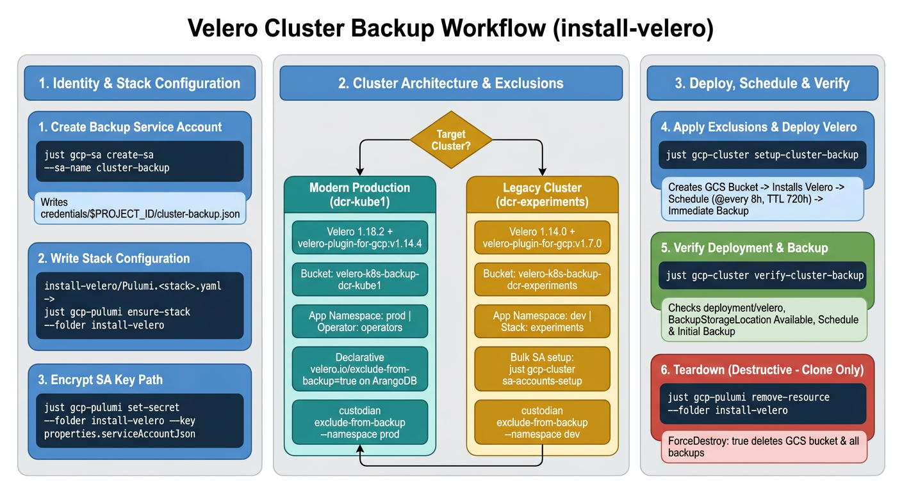

# Cluster Backup with Velero

The `install-velero/` Pulumi project deploys **Velero** into the `operators` namespace and creates a versioned Google Cloud Storage (GCS) backup bucket. The project also creates a recurring backup schedule and runs an immediate initial backup.

Stateful datastores (ArangoDB, CloudNativePG PostgreSQL, Redis, and MinIO) run their own dedicated GCS backup pipelines (`arangodb-backup`, Barman Cloud `ObjectStore`, `redis-backup`, and `minio-backup`). Before you install Velero, the exclusion step adds the `velero.io/exclude-from-backup=true` label to `kube-arangodb` objects and adds the `backup.velero.io/backup-volumes-excludes` annotation to pods in the application namespace (`prod` on `dcr-kube` clusters, `dev` on `dcr-experiments`).

**Status**: Legacy procedure (`dcr-experiments`), updated to support `dcr-kube` (`dcr-kube1`) stacks. On `dcr-kube` clusters, use [`cluster-clone.md`](cluster-clone.md) for full declarative cluster cloning instead of Velero. For the legacy `dcr-experiments` setup, refer to [Legacy `dcr-experiments` Setup](reference/velero/deployment.md#legacy-dcr-experiments-setup).



## Table of Contents

- [Quick Reference](#quick-reference)
- [1. Create the Backup Service Account](#1-create-the-backup-service-account)
- [2. Write the Stack Configuration](#2-write-the-stack-configuration)
- [3. Encrypt the Service Account Key Path](#3-encrypt-the-service-account-key-path)
- [4. Exclude Datastore Volumes and Deploy Velero](#4-exclude-datastore-volumes-and-deploy-velero)
- [5. Verify the Backup](#5-verify-the-backup)
- [6. Teardown](#6-teardown)
- [7. Troubleshooting](#7-troubleshooting)
- [8. Related Documents](#8-related-documents)

---

## Quick Reference

For experienced operators. Full details are in the sections below.

```bash
# Enter the cluster environment first
just cluster-env --env prod --cluster <prod-cluster>

# 1. Create the cluster-backup service account and key in credentials/$PROJECT_ID/cluster-backup.json
just gcp-sa create-sa --sa-name cluster-backup

# 2. Write the production stack configuration and initialize the stack
${EDITOR:-vi} "install-velero/Pulumi.${PULUMI_STACK}.yaml"
just gcp-pulumi ensure-stack --folder install-velero

# 3. Store the relative path to the service account JSON key as a Pulumi secret
just gcp-pulumi set-secret \
  --folder install-velero \
  --key properties.serviceAccountJson \
  --value "../credentials/${PROJECT_ID}/cluster-backup.json"

# 4. Exclude datastore volumes in prod, then preview and deploy Velero
just gcp-cluster setup-cluster-backup

# 5. Verify the Velero deployment, storage location, schedule, and initial backup
just gcp-cluster verify-cluster-backup
```

Optional commands:

```bash
# Re-apply pod volume exclusions in prod after new pods start
just gcp-cluster exclude-from-backup

# Legacy dcr-experiments setup (stack experiments, application namespace dev)
just gcp-cluster setup-cluster-backup --stack experiments --namespace dev

# Teardown (destructive — deletes the GCS backup bucket and all backups)
just gcp-pulumi remove-resource --folder install-velero
```

---

**All of the commands below run in the cluster-env sub-shell.**

- Enter the sub-shell with `just cluster-env --env prod --cluster <prod-cluster>`. The sub-shell reads `.env.prod.<prod-cluster>` and exports `CLUSTER_NAME`, `PULUMI_STACK`, `PULUMI_BACKEND_URL`, `PULUMI_GCP_CREDENTIALS`, `PULUMI_SECRET_PROVIDER`, `PROJECT_ID`, and `KUBECONFIG`.
- Each recipe defaults `--stack` to `$PULUMI_STACK` and `--namespace` to `prod`. No command below needs those flags.
- Outside the sub-shell the recipes fail with `Error: no stack name`.
- Leave the sub-shell with `exit` or Ctrl-D.

## 1. Create the Backup Service Account

Create the `cluster-backup` GCP service account with the roles in `gcs-files/roles-permissions/cluster-backup-roles.txt` and write the key to `credentials/${PROJECT_ID}/cluster-backup.json`. If the key file already exists on disk, the recipe skips key creation.
→ [Service account setup](reference/velero/deployment.md#service-account-setup)

```bash
just gcp-sa create-sa --sa-name cluster-backup
```

---

## 2. Write the Stack Configuration

Write `install-velero/Pulumi.${PULUMI_STACK}.yaml` from the production template, then run `ensure-stack` to initialize the stack with the cluster KMS key. Keep `bucket`, `namespace`, `plugins`, `provider`, and `schedule` in plain text.
→ [Stack configuration](reference/velero/deployment.md#stack-configuration) · [Legacy `dcr-experiments` setup](reference/velero/deployment.md#legacy-dcr-experiments-setup)

```bash
${EDITOR:-vi} "install-velero/Pulumi.${PULUMI_STACK}.yaml"
just gcp-pulumi ensure-stack --folder install-velero
```

---

## 3. Encrypt the Service Account Key Path

Set `properties.serviceAccountJson` to the key file path relative to `install-velero/`. The `velero install --secret-file` command reads this file from disk during `pulumi up`.
→ [Service account key path](reference/velero/deployment.md#service-account-key-path)

```bash
just gcp-pulumi set-secret \
  --folder install-velero \
  --key properties.serviceAccountJson \
  --value "../credentials/${PROJECT_ID}/cluster-backup.json"
```

---

## 4. Exclude Datastore Volumes and Deploy Velero

Set the Velero client namespace, label `kube-arangodb` resources, annotate pod volumes in `prod`, and apply the `install-velero` stack. Re-run `just gcp-cluster exclude-from-backup` whenever new stateful pods start in `prod`.
→ [Deploy behavior](reference/velero/deployment.md#deploy-behavior) · [Datastore and volume exclusions](reference/velero/deployment.md#datastore-and-volume-exclusions)

```bash
just gcp-cluster setup-cluster-backup
```

---

## 5. Verify the Backup

Check that Deployment `velero` is available, `BackupStorageLocation` `default` is `Available`, the backup `Schedule` exists, and the initial `Backup` exists. The recipe exits non-zero if any check fails.
→ [Verification](reference/velero/deployment.md#verification)

```bash
just gcp-cluster verify-cluster-backup
```

---

## 6. Teardown

**Destructive. Clone only.** The GCS bucket has `ForceDestroy: true`, so teardown deletes the bucket and all Velero backup archives.
→ [Teardown](reference/velero/deployment.md#teardown)

```bash
just gcp-pulumi remove-resource --folder install-velero
```

---

## 7. Troubleshooting

→ [Troubleshooting table](reference/velero/deployment.md#troubleshooting)

---

## 8. Related Documents

**Reference details for this guide:**
- [Velero cluster backup details](reference/velero/deployment.md)
- [Datastore and volume exclusions](reference/velero/deployment.md#datastore-and-volume-exclusions)
- [Legacy `dcr-experiments` setup](reference/velero/deployment.md#legacy-dcr-experiments-setup)
- [Day-2 operations and restore](reference/velero/deployment.md#day-2-operations-and-restore)
- [Troubleshooting](reference/velero/deployment.md#troubleshooting)

**Other documentation:**
- Declarative cluster clone (`dcr-kube`): [`cluster-clone.md`](cluster-clone.md)
- Cluster bootstrap: [`kops-setup.md`](kops-setup.md)
- Pulumi backend and namespaces: [`pulumi-setup.md`](pulumi-setup.md)
- ArangoDB backup and restore: [`arangodb-deploy.md`](arangodb-deploy.md)
- PostgreSQL backup and restore: [`postgres-deploy.md`](postgres-deploy.md)
- Redis backup: [`redis-deploy.md`](redis-deploy.md)
- MinIO deploy and live bucket mirror: [`minio-deploy.md`](minio-deploy.md)
